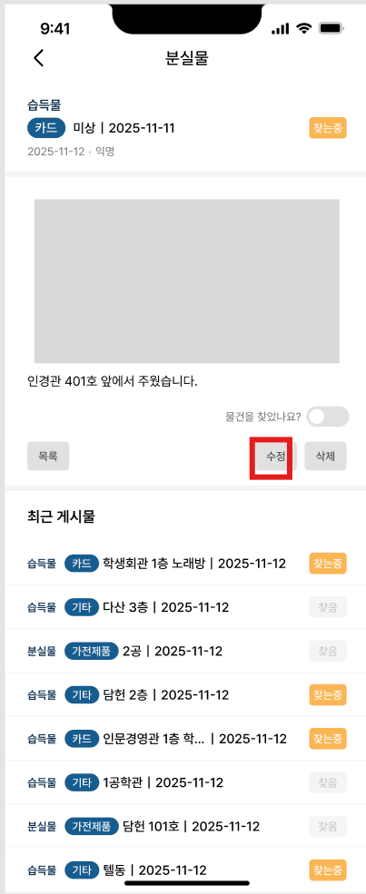
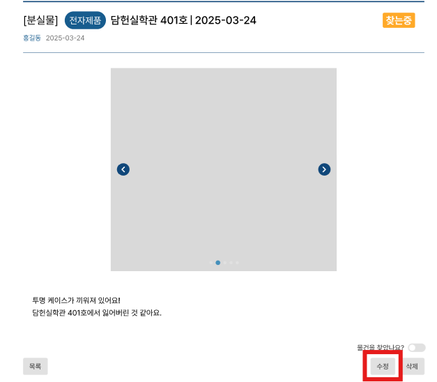
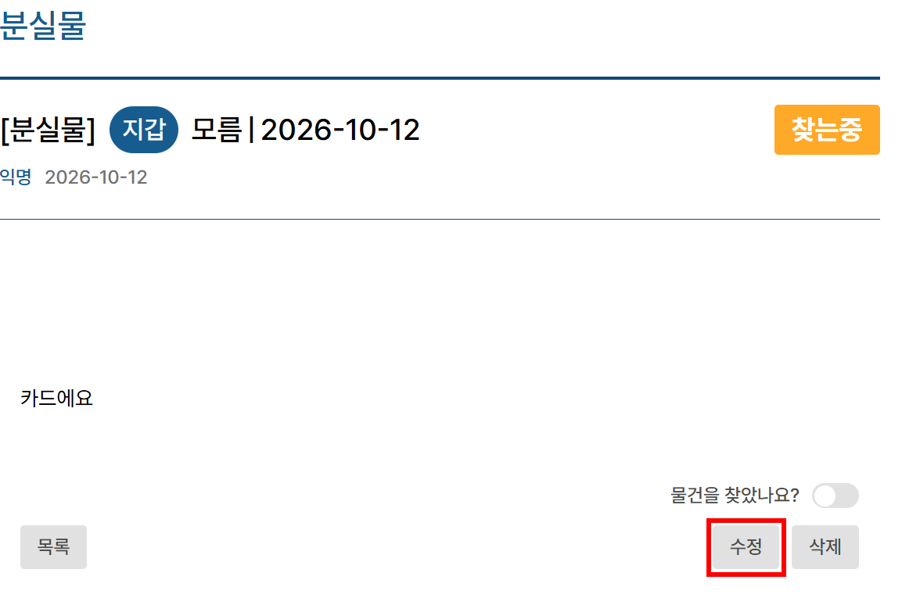
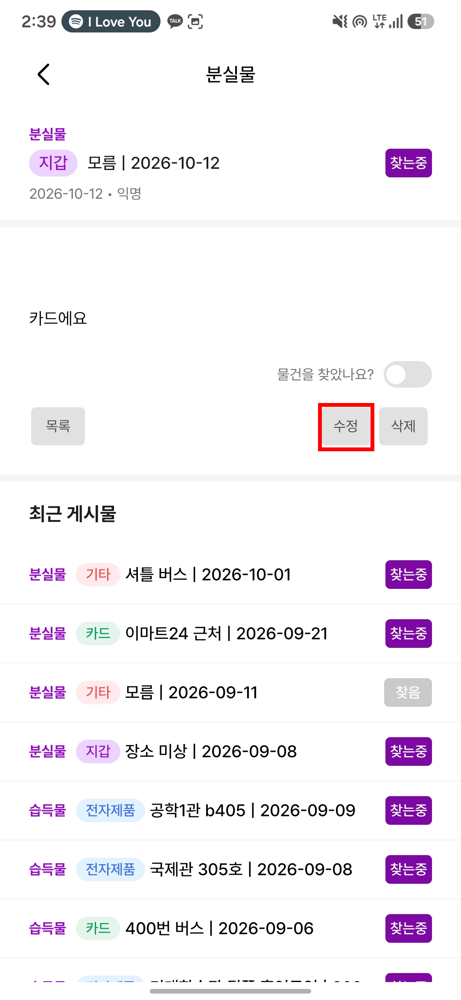

# 11-29. 분실물_수정_버튼_클릭

원문 페이지 ID: 8a20221954bc839096228141c738d3e2

> 원문 스냅샷. 명세 확정·앱 배포·수집 완료를 뜻하지 않습니다.

## 원문 속성

```json
{
  "platform": [
    "ANDROID",
    "IOS",
    "WEB"
  ],
  "url": "source-page-id:8a20221954bc839096228141c738d3e2",
  "상태": "완료",
  "이름": "11-29. 분실물\\_수정\\_버튼\\_클릭",
  "태그": [
    "11.분실물"
  ]
}
```

<details>
<summary>이전 로깅</summary>

- 설명: 분실물 글에서 수정 버튼을 클릭
- event\_label : lost\_item\_modify
- value : ‘습득물’ or ‘분실물’
- event\_category : click
- 참고사진




</details>

<details>
<summary>새 로깅 (26.10.12) — 적용 대상 · 2026-10-16 확정</summary>

- 설명: 분실물 글에서 수정 버튼을 클릭
- screen\_view: <code>lost_item_detail</code>
- event\_name: <code>DA2</code>
- event\_label: <code>board__lost_item_detail__lost_item_edit__entry__click</code>
- value: 분실물 / 습득물
- event\_category: <code>click</code>

<details>
<summary>검토사항</summary>

- 통합 가이드·후속: [로깅 통합 가이드](3c30221954bc8214b1c481c5bbb6fba5.md)
- label 통일 (2026-10-27): <code>board__lost_item_detail__lost_item_edit__entry</code> → <code>board__lost_item_detail__lost_item_edit__entry__click</code>
- 확정 (2026-10-16): 실제 제공되는 분실물·습득물 수정 진입 로깅으로 적용 대상이다. 보류 문구를 제거한다. 상세 화면의 수정 버튼 클릭 순간 전송하며 screen\_view는 lost\_item\_detail을 유지한다.
</details>

### 참고사진 (기능 표시)

<columns>
<column ratio="50">
<b>웹</b>

<details>
<summary>참고사진 · 웹</summary>

웹 — 본인 게시물 수정


</details>
</column>
<column ratio="50">
<b>모바일</b>

<details>
<summary>참고사진 · 모바일</summary>

모바일 — 본인 게시물 수정


</details>
</column>
</columns>
</details>
