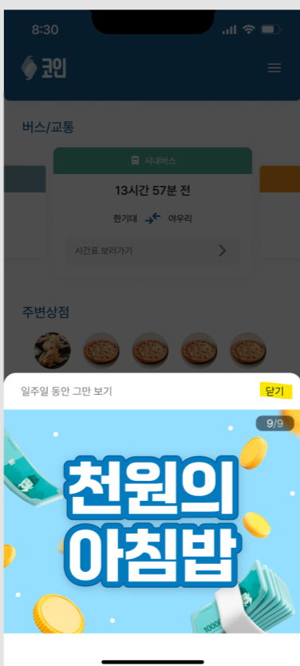
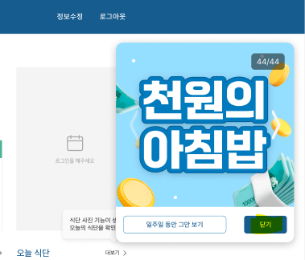
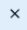

# 1-3. 메인_모달닫기_클릭

원문 페이지 ID: 8b40221954bc82cd91bf01330ca8180a

> 원문 스냅샷. 명세 확정·앱 배포·수집 완료를 뜻하지 않습니다.

## 원문 속성

```json
{
  "platform": [
    "ANDROID",
    "IOS"
  ],
  "url": "source-page-id:8b40221954bc82cd91bf01330ca8180a",
  "상태": "로깅 필요",
  "이름": "1-3. 메인\\_모달닫기\\_클릭",
  "태그": [
    "1. 메인_모달"
  ]
}
```

<details>
<summary>과거 로깅</summary>

- 설명: 메인화면 모달의 닫기를 클릭
- event\_name : “CAMPUS”
- event\_label : “main\_modal\_close”
- value : \{title값\}
- event\_category : “click”
- 참고사진



- 웹 참고사진


</details>

<details>
<summary>새 로깅</summary>

- 설명: 메인 화면의 배너 모달에서 닫기 버튼을 클릭.
- screen\_view:  main
- event\_name: <code>DA2</code>
- event\_label: <code>banner__main__modal__close__click</code>
- value: \{배너 ID\}
- event\_category: <code>click</code>

<b>참고사진 · 웹</b>

<b>웹 - 없음</b>

<b>참고사진 · 모바일</b>

<b>모바일</b>




</details>
