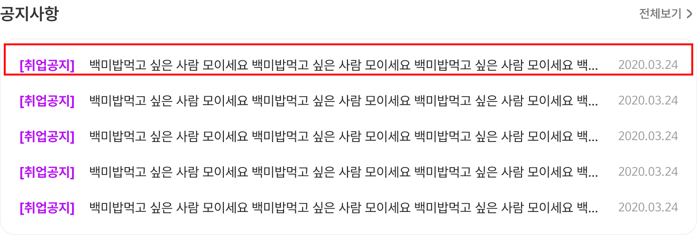

# 1-3. 메인_공지사항_상세_클릭

원문 페이지 ID: 8b40221954bc832b99b98183f121b2cc

> 원문 스냅샷. 명세 확정·앱 배포·수집 완료를 뜻하지 않습니다.

## 원문 속성

```json
{
  "platform": [
    "WEB"
  ],
  "url": "source-page-id:8b40221954bc832b99b98183f121b2cc",
  "상태": "로깅 필요",
  "이름": "1-3. 메인\\_공지사항\\_상세\\_클릭",
  "태그": [
    "1. 메인_공지사항"
  ]
}
```

<details>
<summary>과거 로깅</summary>

- 설명: 공지사항 페이지에서 가장 많이본 게시물 1\~10번중 클릭했을때
- event\_label : “notice\_hot”
- value : “”
- event\_category : “click”
- 참고사진


</details>

<details>
<summary>새 로깅</summary>

<ul>
<li>
설명: 메인 화면의 공지사항 영역에서 게시글을 클릭하여 공지 상세 화면으로 이동.
</li>
<li>
screen\_view: <code>main</code>
</li>
<li>
event\_name: <code>DA2</code>
</li>
<li>
event\_label: <code>board__main__notice_detail__entry__click</code> 
</li>
<li>
value: \{공지ID\}

- ID가 안되면 공지제목으로 넣어주시면 감사하겠습니다! (조치 후 결과 아래에 남겨주세요)
</li>
<li>
event\_category: <code>click</code>
</li>
</ul>

### 참고사진 (홈 공지사항 → 게시글 첫 행 (예시) · WEB 리디자인)

<b>웹</b>

<b>참고사진 · 웹</b>

홈 공지사항 → 게시글 첫 행 (예시). 출처: [Figma WEB 리디자인](https://www.figma.com/design/DPlcYuiFxhyT5ULbqec59i/KOIN-Web?node-id=11541-33352), 2026-11-04 원본 캡처에 코드로 빨간 네모만 추가. 빨간 네모는 기존 명세가 지칭하는 클릭 대상이다. 실제 클릭 가능 여부·SDK 적용·배포·수집은 미확인이다.


</details>
