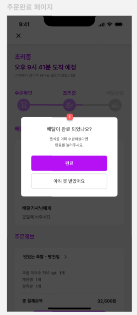
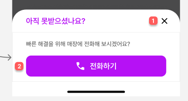

# 8-5 주문 완료 페이지 배달 미도착 전화

원문 페이지 ID: 8b40221954bc83d4b1a281fde04ce02c

> 원문 스냅샷. 명세 확정·앱 배포·수집 완료를 뜻하지 않습니다.

## 원문 속성

```json
{
  "platform": [
    "WEB"
  ],
  "url": "source-page-id:8b40221954bc83d4b1a281fde04ce02c",
  "상태": "로깅 필요",
  "생성일": "2026-11-08T10:51:55.948Z",
  "이벤트 이름": "8-5 주문 완료 페이지 배달 미도착 전화"
}
```

<columns>
<column ratio="50">

</column>
<column ratio="50">



</column>
</columns>


배달을 아직 못 받은 경우 → 전화하기 클릭 로깅입니다


event\_params.key

- event\_label : order\_comlete\_notRecievedCall
- value :
- event\_category :
  - click
