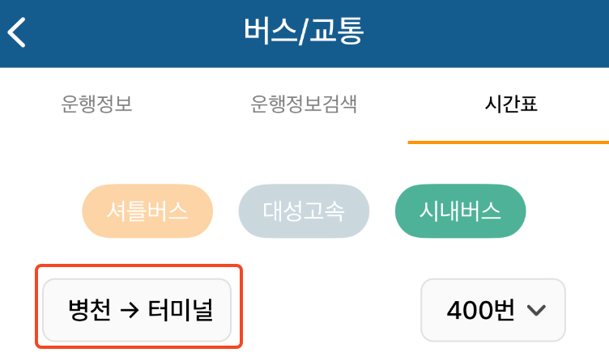

# 3-11. 버스_시간표_시내버스_목적지_클릭

원문 페이지 ID: 8d00221954bc83898310018b8cd09d72

> 원문 스냅샷. 명세 확정·앱 배포·수집 완료를 뜻하지 않습니다.

## 원문 속성

```json
{
  "platform": [
    "ANDROID",
    "IOS",
    "WEB"
  ],
  "url": "source-page-id:8d00221954bc83898310018b8cd09d72",
  "구분": "시간표 (WEB / Android / iOS)",
  "상태": "레거시",
  "생성일": "2026-11-08T10:51:41.740Z",
  "이벤트 이름": "3-11. 버스\\_시간표\\_시내버스\\_목적지\\_클릭",
  "태그": [
    "3. 버스/교통 상세 페이지"
  ]
}
```

<details>
<summary>이전 로깅</summary>

- event\_label : “bus\_timetable\_citybus”
- value : “OOO → OOO<b>”</b>
  - 병천 → 터미널, 터미널 → 병천
- event\_category : “click”
- 참고사진


</details>

<details>
<summary>새 로깅 (26.10.17)</summary>

- 레거시: 지금 앱에 없는 화면(구 시간표의 시내버스 목적지 선택)이라 새 로깅을 만들지 않는다.
- 대체 로깅: 4-11. 시내버스 운행방면\_클릭 (<code>bus__bus_timetable__filter__city_direction__select</code>)

<details>
<summary>검토사항</summary>

- 통합 가이드: [로깅 통합 가이드](3c30221954bc8214b1c481c5bbb6fba5.md)
- 레거시 항목이라 새 로깅·참고사진 없음.
</details>

### 참고사진 (기능 표시)

<columns>
<column ratio="50">
<b>웹</b>

<details>
<summary>참고사진 · 웹</summary>

웹 — 해당 없음 (레거시)
</details>
</column>
<column ratio="50">
<b>모바일</b>

<details>
<summary>참고사진 · 모바일</summary>

모바일 — 해당 없음 (레거시)
</details>
</column>
</columns>
</details>
