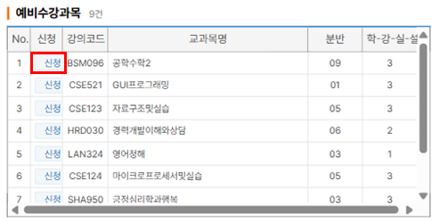

# 1-4. 모의수강신청_예비수강과목 신청 클릭

원문 페이지 ID: 8db0221954bc8239841c01b8d00d3d71

> 원문 스냅샷. 명세 확정·앱 배포·수집 완료를 뜻하지 않습니다.

## 원문 속성

```json
{
  "platform": [
    "WEB"
  ],
  "url": "source-page-id:8db0221954bc8239841c01b8d00d3d71",
  "상태": "로깅 필요",
  "이름": "1-4. 모의수강신청\\_예비수강과목 신청 클릭",
  "태그": [
    "1. 모의수강신청_메인화면"
  ]
}
```

<details>
<summary>과거 로깅</summary>

<ul>
<li>
event\_label : “application\_training<span color="blue">\_pre\_apply</span>” 
</li>
<li>
value: 
</li>
<li>
event\_category : “click”
</li>
<li>
참고 이미지
</li>
</ul>


</details>

<details>
<summary>새 로깅</summary>

- 설명: 모의수강신청 화면의 예비수강과목에서 신청 버튼을 클릭한다.
- screen\_view: <code>course_practice</code>
- event\_label: <code>course_practice__course_practice__course_application__preselected__click</code>
- event\_name: <code>DA2</code>
- value: 기존 미기재 유지
- event\_category: <code>click</code>

### 참고사진 (기능 표시)

<b>웹(데스크톱)</b>

<b>참고사진 · 웹</b>

기존 웹 명세 캡처 사본. 예비수강과목 영역과 신청 버튼은 2026-10-15 로그인 후 실제 WEB에서도 확인했다. 아래 사진 자체는 기존 자료다.


</details>
