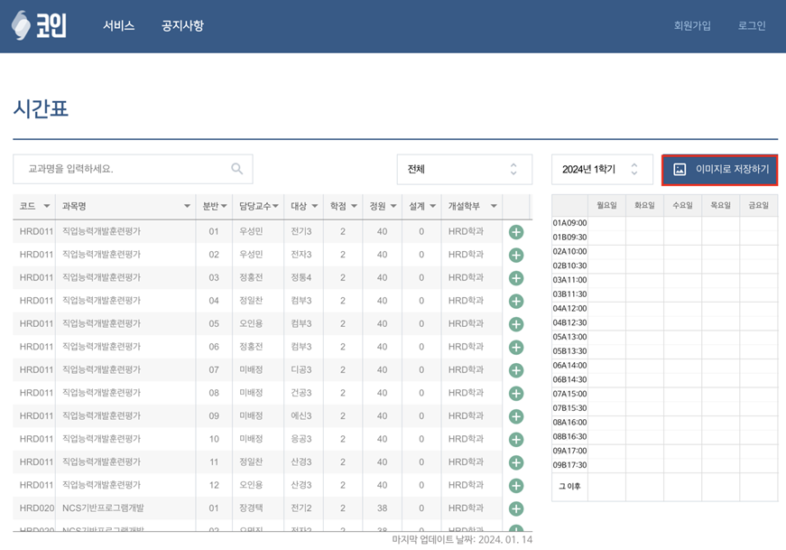
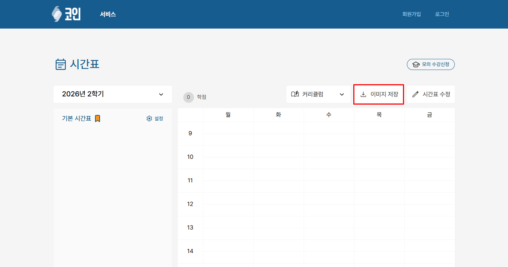
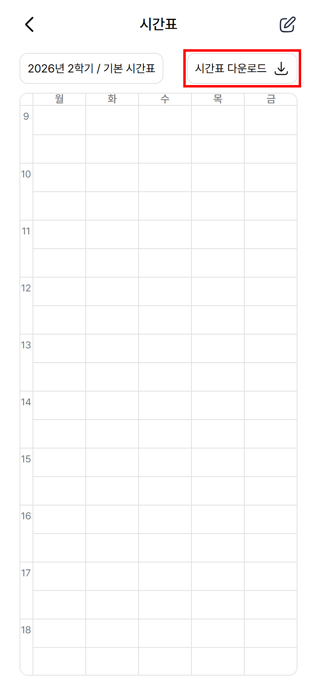

# 2-6. 시간표_이미지 저장 (클릭)

원문 페이지 ID: 8e10221954bc8304818b817ab7b35436

> 원문 스냅샷. 명세 확정·앱 배포·수집 완료를 뜻하지 않습니다.

## 원문 속성

```json
{
  "platform": [
    "WEB",
    "ANDROID",
    "IOS"
  ],
  "url": "source-page-id:8e10221954bc8304818b817ab7b35436",
  "상태": "완료",
  "생성일": "2026-11-08T10:52:11.612Z",
  "이벤트 이름": "2-6. 시간표\\_이미지 저장 (클릭)",
  "태그": [
    "시간표"
  ]
}
```

<details>
<summary>이전 로깅</summary>

- event\_label : “timetable”
- value : “이미지저장”
- event\_category : “click”
- 참고 이미지


</details>

<details>
<summary>새 로깅 (26.10.17)</summary>

- 설명: 시간표 화면에서 이미지 저장(모바일은 시간표 다운로드) 버튼을 눌러 시간표를 이미지로 내려받는 경우
- screen\_view: <code>timetable</code>
- event\_name: <code>DA1</code>
- event\_label: <code>timetable__timetable__timetable_export__image_save__click</code>
- value: 이미지 저장
- event\_category: <code>click</code>

<details>
<summary>검토사항</summary>

- 지원 플랫폼 근거 (2026-10-30): 공개 develop 코드의 Android TimetableActivity에서 다운로드 진입·확인 후 saveTimetable → saveBitmapImage 호출, iOS TimetableViewController에서 시간표 다운로드 버튼 → downloadTimetableAsImage → UIImageWriteToSavedPhotosAlbum 호출을 확인했다. 명세의 기존 모바일 설명에 맞춰 platform을 WEB·ANDROID·IOS로 정렬했다. 기능 코드 확인이며 배포 버전·실기기 사진·새 DA1 label 전송 완료를 뜻하지 않는다.
- 코드 출처: [Android 다운로드·저장 호출](https://github.com/BCSDLab/KOIN_ANDROID/blob/ee67a50f554030a76cfb7d8948b89d8efc806e9d/koin/src/main/java/in/koreatech/koin/ui/timetablev2/TimetableActivity.kt#L220-L280) · [iOS 다운로드·사진 저장 호출](https://github.com/BCSDLab/KOIN_iOS/blob/ea494b30ffa6197d62592369f7ae4265ced2e678/Koin/Presentation/TimeTable/Timetable/TimetableViewController.swift#L544-L555)
- 통합 가이드·후속: [로깅 통합 가이드](3c30221954bc8214b1c481c5bbb6fba5.md)
- 모바일: 버튼 이름은 '시간표 다운로드'지만 같은 기능이라 같은 label·value로 보낸다
- label DA2 기준 정렬 (2026-10-27): <code>timetable__timetable__image_save__click</code> → <code>timetable__timetable__timetable_export__image_save__click</code>
</details>

### 참고사진 (기능 표시)

<columns>
<column ratio="50">
<b>웹</b>

<details>
<summary>참고사진 · 웹</summary>

웹 — 이미지 저장 (출처: stage 실제 캡처, 빨간 네모 = 클릭 위치)


</details>
</column>
<column ratio="50">
<b>모바일</b>

<details>
<summary>참고사진 · 모바일</summary>

모바일 — 시간표 다운로드 (출처: stage 실제 캡처, 빨간 네모 = 클릭 위치)


</details>
</column>
</columns>
</details>
