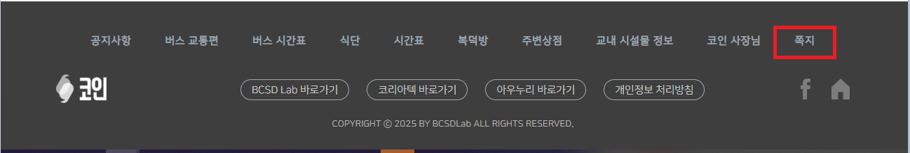

# 11-19.푸터_쪽지_클릭

원문 페이지 ID: 8f40221954bc82bdba648191e2954c8e

> 누락 원본 복구 스냅샷. 원본의 과거값·검토 기록을 보존하며 생성 계약으로 자동 승인하지 않습니다.

대조 기록: [87개 원본 복구 및 8개 차이 정리](../recovery-review.md)

관련 기존 보관본: [11-19.푸터_쪽지_클릭](1a70221954bc83408a1381789c552b4f.md), [11-19.푸터_쪽지_클릭](05d0221954bc82c8a85b8139b750cbb8.md)

## 원문 속성

```json
{
  "platform": [
    "WEB"
  ],
  "url": "source-page-id:8f40221954bc82bdba648191e2954c8e",
  "상태": "완료",
  "이름": "11-19.푸터\\_쪽지\\_클릭"
}
```

- 설명:  웹 페이지 푸터 에서 쪽지 버튼 클릭
- event\_label : “footer”
- value : “쪽지”
- event\_category : “click”
- 참고사진


WEB





<details>
<summary>검토사항</summary>


- 후속 수정 (2026-10-27): ※ 옛 사본: 현행 명세는 게시판 DB의 같은 번호 페이지 [11-19.푸터_쪽지_클릭](1a70221954bc83408a1381789c552b4f.md). 이 사본은 새 로깅이 없어 변환하지 않음.

</details>
