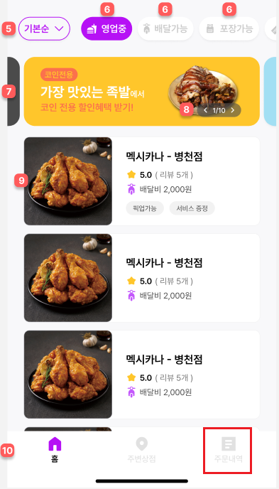

# 2-21 상점 카테고리 → 주문내역

원문 페이지 ID: 9060221954bc8292b85d812866540282

> 원문 스냅샷. 명세 확정·앱 배포·수집 완료를 뜻하지 않습니다.

## 원문 속성

```json
{
  "platform": [
    "ANDROID",
    "IOS"
  ],
  "url": "source-page-id:9060221954bc8292b85d812866540282",
  "상태": "로깅 필요",
  "생성일": "2026-11-08T10:51:48.410Z",
  "이벤트 이름": "2-21 상점 카테고리 → 주문내역",
  "태그": [
    "2. 상점 카테고리"
  ]
}
```

<details>
<summary>이전 로깅</summary>




<span color="orange">event\_params.key</span>

<ul>
<li>
event\_label : shop\_categories\_order
</li>
<li>
value :  \{카테고리\}
</li>
<li>
event\_category : click 
</li>
<li>
duration\_time : 이전 카테고리에서 현 카테고리로 이동하는 시간 
</li>
<li>
previous\_page : \{이전 카테고리\}
</li>
<li>
current\_page : \{현 카테고리\}
</li>
</ul>
</details>

<details>
<summary>새 로깅 (26.10.17)</summary>

- 설명: (앱 주문 기능) 상점 목록 화면 하단 탭에서 주문내역을 눌러 주문내역 화면으로 이동하는 경우
- screen\_view: <code>shop_list</code>
- event\_name: <code>DA1</code>
- event\_label: <code>shop__shop_list__navigation__order_history_entry__click</code>
- value: 주문내역
- event\_category: <code>click</code>

<details>
<summary>검토사항</summary>

- 통합 가이드: [로깅 통합 가이드](3c30221954bc8214b1c481c5bbb6fba5.md)
- 웹: 없음 (stage 웹 상점 목록에 주문내역 버튼 없음). DB platform을 ANDROID, IOS로 맞춤.
- label DA2 기준 정렬 (2026-10-27): <code>shop__shop_list__order_history__click</code> → <code>shop__shop_list__navigation__order_history_entry__click</code>
- 참고사진: 앱 전용 화면 (웹 없음), 앱 캡처 필요
</details>

### 참고사진 (하단 탭 주문내역)

<columns>
<column ratio="50">
<b>웹</b>

<details>
<summary>참고사진 · 웹</summary>

해당 없음 (앱 전용)
</details>
</column>
<column ratio="50">
<b>모바일</b>

<details>
<summary>참고사진 · 모바일</summary>

앱 전용 화면 (웹 없음), 앱 캡처 필요
</details>
</column>
</columns>
</details>
