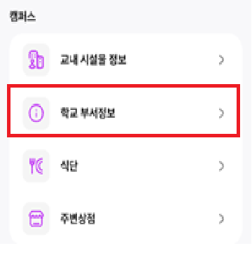
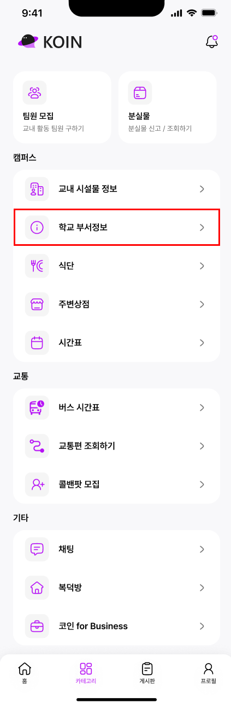

# [레거시] 1-0-2 학교 부서정보 접근 (카테고리 진입)

원문 페이지 ID: 92a0221954bc83aca644818982a43843

> 원문 스냅샷. 명세 확정·앱 배포·수집 완료를 뜻하지 않습니다.

## 원문 속성

```json
{
  "platform": [
    "ANDROID",
    "IOS"
  ],
  "url": "source-page-id:92a0221954bc83aca644818982a43843",
  "구분": "학교 부서정보",
  "상태": "레거시",
  "생성일": "2026-11-12T05:08:04.421Z",
  "이벤트 이름": "\\[레거시\\] 1-0-2 학교 부서정보 접근 (카테고리 진입)"
}
```

<details>
<summary>과거 로깅</summary>

- event\_label : category\_campus
- value : 학교 부서정보
- event\_category : click





- 설명: 앱 카테고리 화면에서 학교 부서정보를 클릭한다.
- screen\_view: <code>main_category</code>
- event\_label: <code>department__main_category__department_entry__category_entry__click</code>
- event\_name: <code>DA2</code>
- event\_category: <code>click</code>
- value: 학교 부서정보

<b>참고사진 (기능 표시)</b>

<b>모바일 (ANDROID, IOS) / 캡처 출처는 아래 참조</b>

화면 정의에 제공된 카테고리 캡처. 실제 Android 캡처 출처는 미확인; 메뉴 위치 참고.


</details>

<details>
<summary>새 로깅</summary>

레거시. [3-6 카테고리 내부 클릭 (현재 로깅) 2026.08.30 이후 찍히는 로깅](5540221954bc83d0aed681206affda1b.md)를 따른다.
</details>
