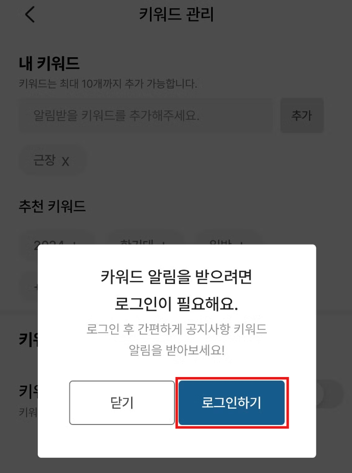

# 7-6. 로그인팝업_로그인하기_클릭

원문 페이지 ID: 92b0221954bc8351ac0601705df4922d

> 원문 스냅샷. 명세 확정·앱 배포·수집 완료를 뜻하지 않습니다.

## 원문 속성

```json
{
  "platform": [
    "ANDROID",
    "IOS"
  ],
  "url": "source-page-id:92b0221954bc8351ac0601705df4922d",
  "상태": "로깅 필요",
  "이름": "7-6. 로그인팝업\\_로그인하기\\_클릭",
  "태그": [
    "7. 키워드 관리(APP)"
  ]
}
```

<details>
<summary>이전 로깅</summary>




</details>

<details>
<summary>새 로깅 (26.10.05) — 초안</summary>

- 설명: 키워드 관리 화면의 로그인 안내 팝업에서 로그인하기 버튼 클릭.
- screen\_view: <code>notice_keyword_manage</code>
- event\_name: <code>DA2</code>
- event\_label: <code>account__notice_keyword_manage__login_popup__login_entry__click</code>
- value: 로그인하기
- event\_category: <code>click</code>

<details>
<summary>검토사항</summary>

- label 통일 (2026-10-27): <code>account__notice_keyword_manage__login_popup__login_entry</code> → <code>account__notice_keyword_manage__login_popup__login_entry__click</code>
</details>

<details>
<summary>참고사진 · 모바일</summary>

<b>모바일</b>

파란색 구버전 모바일 사진 제거 (2026-10-30).
</details>
</details>
