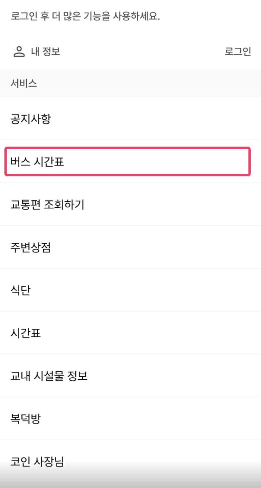

# 2-6. (앱) 햄버거_버스 시간표_클릭 → 삭제

원문 페이지 ID: 9300221954bc83d0a705817c2c9244f6

> 원문 스냅샷. 명세 확정·앱 배포·수집 완료를 뜻하지 않습니다.

## 원문 속성

```json
{
  "platform": [
    "ANDROID",
    "IOS",
    "WEB"
  ],
  "url": "source-page-id:9300221954bc83d0a705817c2c9244f6",
  "상태": "로깅 필요",
  "생성일": "2026-11-12T05:07:52.190Z",
  "이벤트 이름": "2-6. (앱) 햄버거\\_버스 시간표\\_클릭 → 삭제",
  "태그": [
    "2. 헤더/푸터/햄버거_버스/교통"
  ]
}
```

<callout icon="📌" color="gray_bg">
2026-11-08 이 옛 앱 햄버거 명세의 삭제·레거시 결정은 유지한다. 현재 모바일 WEB /category의 버스 시간표 메뉴는 원문 (원문 ID: 4120221954bc81c08b5ed63eff880be6)의 새 계약을 따른다. PC 헤더·홈 카드 라벨을 대신 보내거나 이 옛 명세를 되살리지 않는다. SDK 배포·실수집 검수는 별도다.
</callout>

<details>
<summary>이전 로깅</summary>

- event\_label : “hamburger”
- value : “버스 시간표<b>”</b>
- event\_category : “click”
- 참고사진


</details>
