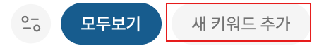

# 7-3. 새 키워드 추가_클릭

원문 페이지 ID: 9360221954bc83e49c8781b4784d4d2b

> 누락 원본 복구 스냅샷. 원본의 과거값·검토 기록을 보존하며 생성 계약으로 자동 승인하지 않습니다.

대조 기록: [87개 원본 복구 및 8개 차이 정리](../recovery-review.md)

관련 기존 보관본: [7-3. 새 키워드 추가_클릭](a510221954bc8243963c01d45432380b.md), [7-3. 새 키워드 추가_클릭](9f20221954bc82f29d99013b23a78bb6.md)

## 원문 속성

```json
{
  "platform": [
    "ANDROID",
    "IOS"
  ],
  "url": "source-page-id:9360221954bc83e49c8781b4784d4d2b",
  "상태": "완료",
  "이름": "7-3. 새 키워드 추가\\_클릭"
}
```


