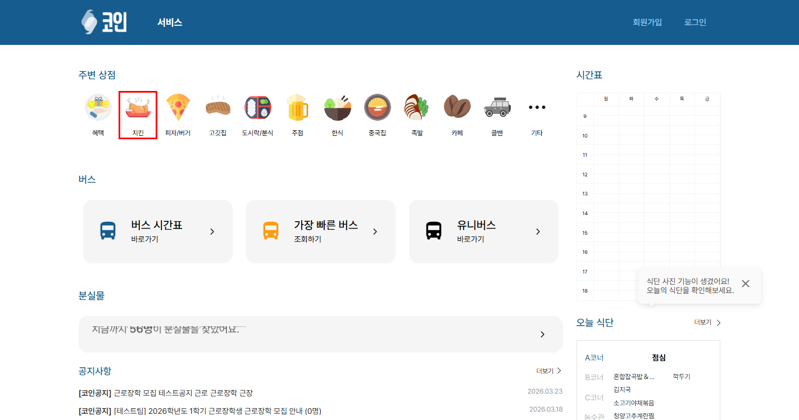

# 1-1 메인 → 상점 카테고리 (클릭) 

원문 페이지 ID: 9460221954bc82fcb1e281492ccd30c7

> 원문 스냅샷. 명세 확정·앱 배포·수집 완료를 뜻하지 않습니다.

## 원문 속성

```json
{
  "platform": [
    "WEB"
  ],
  "url": "source-page-id:9460221954bc82fcb1e281492ccd30c7",
  "상태": "완료",
  "생성일": "2026-11-08T10:51:46.953Z",
  "이벤트 이름": "<p>\n1-1 메인 → 상점 카테고리 (클릭) \n</p>",
  "태그": [
    "1. 메인 -> 카테고리"
  ]
}
```

<details>
<summary>이전 로깅</summary>

<span color="orange">event\_params.key</span>

<ul>
<li>
event\_label : main\_shop\_categories
</li>
<li>
value : \{카테고리\} 
</li>
<li>
event\_category : click <br />
</li>
<li>
previous\_page : 메인
</li>
<li>
current\_page : \{현 카테고리\}
</li>
<li>
duration\_time : 메인페이지에서 상점페이지로 들어온 시간 (ms)
</li>
</ul>


---

<p>
주의사항: 
</p>

<ol>
<li>
메인에서 상점페이지로 넘어올때의 이벤트를 측정하는 것임. 
</li>
</ol>


---

<h3>
오류 사항 
</h3>

[해결](3f80221954bc82fb834d8179c794e49d.md)
</details>

<details>
<summary>새 로깅 (26.10.17)</summary>

- 설명: 구디자인 데스크톱 WEB 홈의 혜택·치킨·피자/버거 등 개별 상점 카테고리 카드를 클릭해 해당 카테고리 목록으로 이동할 때 기록한다. WEB 리디자인의 많이 찾는 상점 카드·전체보기·헤더·푸터 진입은 포함하지 않는다.
- screen\_view: <code>main</code>
- event\_name: <code>DA1</code>
- event\_label: <code>shop__main__shop_entry__category_card_entry__click</code>
- value: \{사용자가 클릭한 카테고리\} → 혜택 / 치킨 / 피자/버거 등 (예: 치킨)
- event\_category: <code>click</code>

<details>
<summary>검토사항</summary>

- WEB 리디자인 대응 검수 (2026-11-05): 기존 카테고리 카드 동작과 새 홈의 단일 인기 상점 카드를 구분한다. 이 명세를 홈 1-9·1-10과 같은 클릭에 함께 전송하지 않는다. 해당 카드 UI가 다시 확인되기 전 리디자인 적용은 미확인으로 남기며 기존 라벨·값·플랫폼·이전 로깅은 유지한다.
- 홈 진입 위치 정렬 (2026-10-28): <code>shop__main__shop_entry__category_entry__click</code> → <code>shop__main__shop_entry__category_card_entry__click</code>. 홈 버튼·카테고리 카드이므로 screen\_view와 label page는 <code>main</code>을 유지한다. 메뉴 화면의 <code>main_category</code>와 구분한다. 기존 value·category·담당자·플랫폼·발생 시점은 유지한다. 이 명세만으로 실제 중복 발화 여부를 확정하지 않는다.
- label DA2 기준 정렬 (2026-10-27 이력, 2026-10-28 현행 대조): <code>shop__main__category__click</code> → <code>shop__main__shop_entry__category_entry__click</code> → 현행 <code>shop__main__shop_entry__category_card_entry__click</code>. 중간 정렬값과 현재 홈 카드 진입값을 구분하며 page/screen=main, 기존 value·category·사진은 유지한다. / 통합 가이드: [로깅 통합 가이드](3c30221954bc8214b1c481c5bbb6fba5.md)
</details>

### 참고사진 (주변상점 카테고리 클릭)

<columns>
<column ratio="50">
<b>웹</b>

<details>
<summary>참고사진 · 웹</summary>

<b>WEB 리디자인 대응 없음 — 현행 클릭 사진 없음</b>

[Figma 홈 원본](https://www.figma.com/design/DPlcYuiFxhyT5ULbqec59i/KOIN-Web?node-id=11541-33352)에는 기존 혜택·치킨·피자/버거 카테고리 카드 목록이 확인되지 않는다. 새 ‘많이 찾는 상점 둘러보기’ 카드는 [1-10 많이 찾는 상점 둘러보기 클릭](99f0221954bc83b6816881eda6dc0be4.md)의 별도 동작이며 이 명세 사진으로 대신 사용하지 않는다.

<details>
<summary>이전 WEB 참고사진 (구디자인·이력 보존)</summary>

웹 — 메인 주변상점 카테고리 클릭 (출처: stage 실제 캡처, 빨간 네모 = 클릭 위치)


</details>
</details>
</column>
<column ratio="50">
<b>모바일</b>

<details>
<summary>참고사진 · 모바일</summary>

모바일 — 해당 없음 (웹 전용)
</details>
</column>
</columns>
</details>
