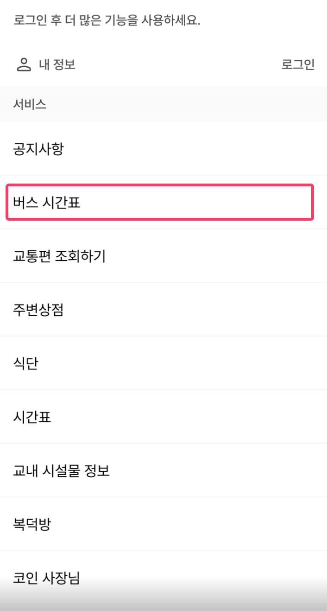

# 2-6. (앱) 햄버거_버스 시간표_클릭 → 삭제

원문 페이지 ID: 94e0221954bc82838d1c01fd4958742f

> 원문 스냅샷. 명세 확정·앱 배포·수집 완료를 뜻하지 않습니다.

## 원문 속성

```json
{
  "platform": [
    "ANDROID",
    "IOS",
    "WEB"
  ],
  "url": "source-page-id:94e0221954bc82838d1c01fd4958742f",
  "상태": "로깅 필요",
  "생성일": "2026-11-08T10:51:40.686Z",
  "이벤트 이름": "2-6. (앱) 햄버거\\_버스 시간표\\_클릭 → 삭제",
  "태그": [
    "2. 헤더/푸터/햄버거_버스/교통"
  ]
}
```

<details>
<summary>이전 로깅</summary>

- event\_label : “hamburger”
- value : “버스 시간표<b>”</b>
- event\_category : “click”
- 참고사진


</details>

<details>
<summary>새 로깅 (26.10.17)</summary>

- 삭제: 제목대로 앱 햄버거 메뉴의 버스 시간표가 없어져 새 로깅을 만들지 않는다.
- 대체 로깅: 1-12. 버스 시간표\_클릭 (<code>bus__main__bus_entry__timetable_entry__click</code>)

<details>
<summary>검토사항</summary>

- 통합 가이드: [로깅 통합 가이드](3c30221954bc8214b1c481c5bbb6fba5.md)
- 삭제 대상 항목이라 참고사진 없음.
</details>

### 참고사진 (기능 표시)

<columns>
<column ratio="50">
<b>웹</b>

<details>
<summary>참고사진 · 웹</summary>

웹 — 해당 없음 (삭제)
</details>
</column>
<column ratio="50">
<b>모바일</b>

<details>
<summary>참고사진 · 모바일</summary>

모바일 — 해당 없음 (삭제)
</details>
</column>
</columns>
</details>
