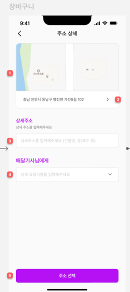

# 7-14 결제 → 교내 및 교외 주문 페이지 주소 선택

원문 페이지 ID: 95a0221954bc83fe81de81b0a79eca54

> 원문 스냅샷. 명세 확정·앱 배포·수집 완료를 뜻하지 않습니다.

## 원문 속성

```json
{
  "platform": [
    "WEB"
  ],
  "url": "source-page-id:95a0221954bc83fe81de81b0a79eca54",
  "상태": "로깅 필요",
  "생성일": "2026-11-08T10:51:32.533Z",
  "이벤트 이름": "7-14 결제 → 교내 및 교외 주문 페이지 주소 선택",
  "태그": [
    "7. 결제 페이지"
  ]
}
```




- 교내 및 교외 동일하게 적용해주시면 됩니다
- 5번 주소 선택 클릭 로깅으로, 다시 결제 페이지로 이동합니다


event\_params.key

- event\_label : payment\_address\_select
- value : ‘선택된 주소’ 로 가능할까요?
- event\_category :
  - click
