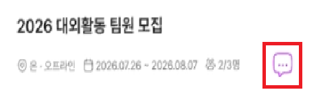
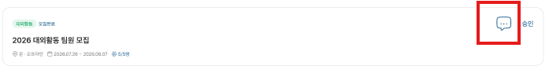

# 8-2. 채팅 클릭

원문 페이지 ID: 95f0221954bc8269aefb01e05590f353

> 원문 스냅샷. 명세 확정·앱 배포·수집 완료를 뜻하지 않습니다.

## 원문 속성

```json
{
  "platform": [
    "WEB",
    "ANDROID",
    "IOS"
  ],
  "url": "source-page-id:95f0221954bc8269aefb01e05590f353",
  "구분": "내가 지원한 모집글",
  "상태": "로깅 필요",
  "생성일": "2026-11-12T05:08:11.895Z",
  "이벤트 이름": "8-2. 채팅 클릭"
}
```

<details>
<summary>과거 로깅</summary>

- event\_label : team\_recruitment\_applied\_post\_chat
- value : 사용자가 채팅을 선택한 모집글 이름
- event\_category : click




</details>

<details>
<summary>새 로깅</summary>

- 설명: 내가 지원한 모집글 화면에서 모집글 카드의 채팅 버튼을 클릭해 작성자와의 채팅방으로 들어가는 경우
- screen\_view: <code>team_applied</code>
- event\_name: <code>DA1</code>
- event\_label: <code>team_recruit__team_applied__chat_entry__entry__click</code>
- value: \{카테고리\}\_\{모집글 id\} (예: 스터디\_100)
- event\_category: <code>click</code>

### 참고사진 (채팅 클릭)

<columns>
<column ratio="50">
<b>웹</b>

<b>참고사진 · 웹</b>

웹 — 사진 없음 (추가 필요)
</column>
<column ratio="50">
<b>모바일</b>

<b>참고사진 · 모바일</b>

모바일 — 사진 없음 (추가 필요)
</column>
</columns>
</details>
