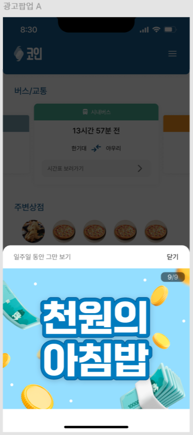

# 👨‍👨‍👧 동아리 (레거시)

원문 페이지 ID: 95f0221954bc835bb9aa8168f3972017

> 원문 스냅샷. 명세 확정·앱 배포·수집 완료를 뜻하지 않습니다.

## 원문 속성

```json
{
  "title": "동아리 (레거시)"
}
```

<callout icon="🗃️" color="gray_bg">
<b>레거시 — 동아리 전체 현행 적용 제외</b>

- 2026-11-04 사용자 지시: 동아리 로깅 전체를 레거시로 보존한다. 기존 명세 55개와 빈 행 2개, 총 57개 DB 행의 상태를 레거시로 정리했다.
- 기존 CAMPUS·label·value·category·사진·플랫폼은 원문 그대로 유지하며 새 service·DA 담당·새 라벨을 만들지 않는다.
- 이 자료는 과거 기록 보존용이며 신규 구현·추가 전송의 기준으로 사용하지 않는다. 실제 SDK 수집 중단·서비스 종료 여부는 이 문서 정리만으로 단정하지 않는다.
</callout>

<callout icon="💡" color="gray_bg">
<details>
<summary>Firebase (<b>screen\_view</b>) 배너</summary>

<columns>
<column ratio="50">
### IOS

\- 메인 배너 모달:   미정
</column>
<column ratio="50">
### ANDROID

\-  메인 배너 모달:   미정
</column>
</columns>


</details>

<callout icon="⚠️" color="gray_bg">
아직 미정인 화면
</callout>
</callout>

<callout icon="⚠️" color="gray_bg">

</callout>


동아리 로깅 (collection-id:53602219-54bc-831b-9416-07ed045d1eab)


