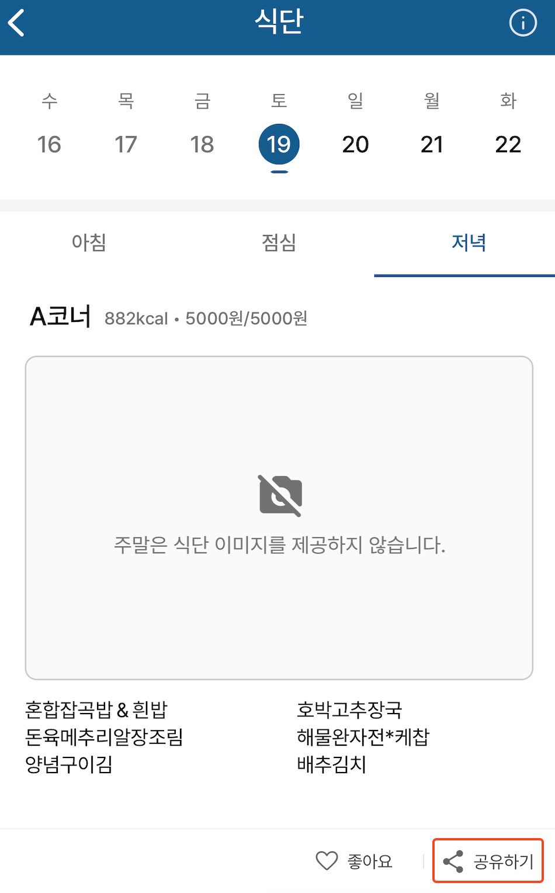
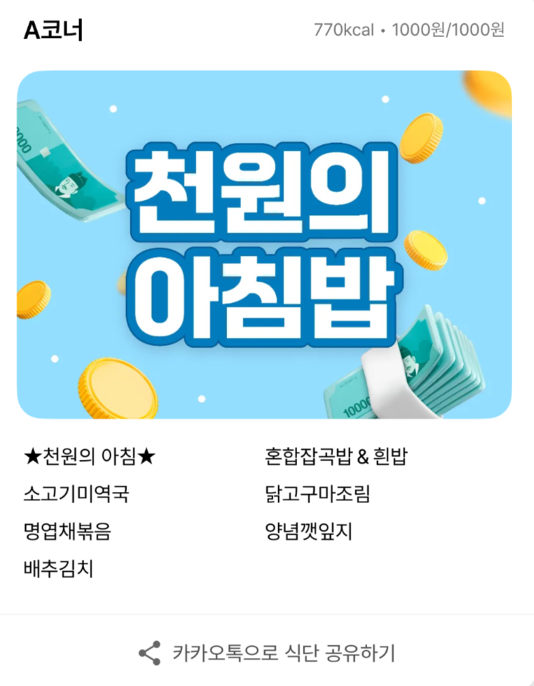

# 3-8. (Android / iOS) 식단_카카오톡_공유하기_클릭

원문 페이지 ID: 9610221954bc82d09b750118aa5dc7aa

> 원문 스냅샷. 명세 확정·앱 배포·수집 완료를 뜻하지 않습니다.

## 원문 속성

```json
{
  "platform": [
    "ANDROID",
    "IOS"
  ],
  "url": "source-page-id:9610221954bc82d09b750118aa5dc7aa",
  "상태": "완료",
  "생성일": "2026-11-12T05:07:49.766Z",
  "이름": "3-8. (Android / iOS) 식단\\_카카오톡\\_공유하기\\_클릭",
  "태그": [
    "3. 식단 상세페이지"
  ]
}
```

<details>
<summary>과거 로깅</summary>

- event\_label : “menu\_share”
- value : “공유하기<b>”</b>
- event\_category : “click”
- 참고사진


</details>

<details>
<summary>새 로깅</summary>

- 설명: 식단 화면에서 카카오톡 공유하기 버튼을 눌러 식단을 공유하는 경우 (식단 퍼널 마지막 단계)
- screen\_view: <code>cafeteria</code>
- event\_name: <code>DA1</code>
- event\_label: <code>cafeteria__cafeteria__share__kakao__click</code>
- value: 공유하기
- event\_category: <code>click</code>

### 참고사진 (카카오톡 공유하기)

<columns>
<column ratio="50">
<b>웹</b>

<b>참고사진 · 웹</b>

해당 없음 (앱 전용)
</column>
<column ratio="50">
<b>모바일</b>

<b>참고사진 · 모바일</b>


</column>
</columns>
</details>
