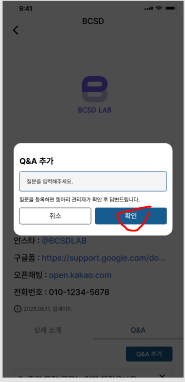
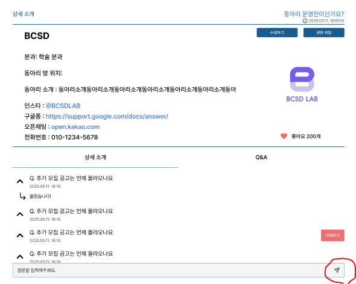

# 4-2. 동아리_Q&A추가_확인

원문 페이지 ID: 9780221954bc83e1938601e62d377ea2

> 사용자 제공 ZIP 내보내기 보관본. 레거시·동결·검토 상태는 원문을 따르며 코드 생성 승인·앱 배포 완료를 뜻하지 않습니다.

platform: ANDROID, IOS, WEB
상태: 완료

- 설명:

모바일 :Q&A 추가 팝업 에서 확인 클릭

웹 : 질문 입력창의 우측에 있는 버튼 클릭

- event_name : “CAMPUS”
- event_label : “club_Q&A_add_confirm”
- value : “Q&A”
- event_category : “click”
- 참고사진

- 웹 참고사진

