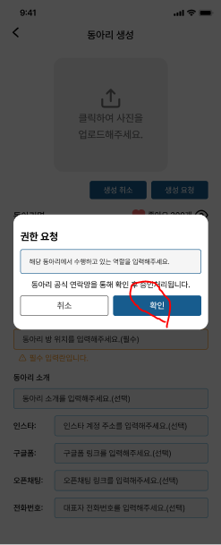
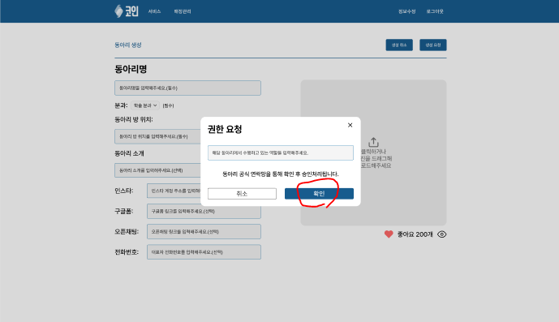

# 3-4. 동아리_동아리 권한요청

원문 페이지 ID: 9880221954bc8260bd94013cf1dac2fe

> 필터 밖 원본 행 복구 스냅샷. 중복·빈 페이지도 원본 ID와 속성, 본문을 개별 보존합니다. 명세 승인이나 앱 적용 완료를 뜻하지 않습니다.

대조 기록: [숨겨진 원본 42개 복구](../hidden-recovery.md)

관련 기존 보관본: [레거시 3-4. 동아리_동아리 권한요청](62d0221954bc8242bec3018118ff27f6.md), [레거시 3-4. 동아리_동아리 권한요청](6050221954bc83af82c2018f6674d3cb.md)

## 원문 속성

```json
{
  "platform": [
    "ANDROID",
    "IOS",
    "WEB"
  ],
  "url": "source-page-id:9880221954bc8260bd94013cf1dac2fe",
  "상태": "완료",
  "이름": "3-4. 동아리\\_동아리 권한요청"
}
```

<ul>
<li>
설명: 동아리 생성 화면의 권한요청 팝업에서 확인 클릭
</li>
<li>
event\_name : “CAMPUS”
</li>
<li>
event\_label : “club\_create\_request\_authority”
</li>
<li>
value : 텍스트 박스 내의 값
</li>
<li>
event\_category : “click” 
</li>
<li>
참고사진
</li>
</ul>





- 웹 참고사진



