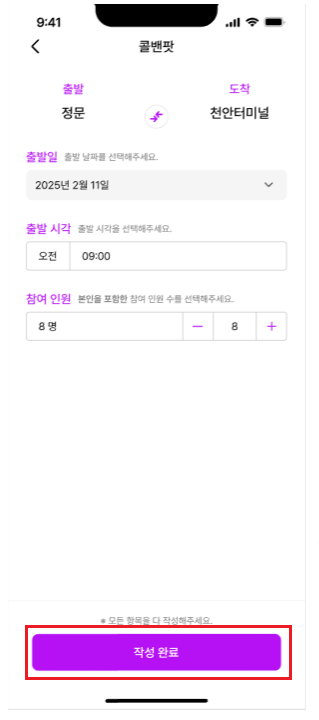
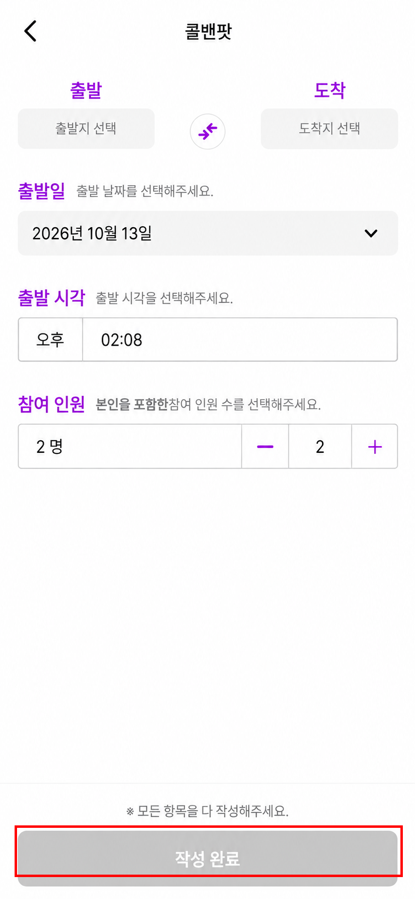

# 3-4 콜밴팟 모집 작성 완료

원문 페이지 ID: 9880221954bc838ea9d7810274423002

> 원문 스냅샷. 명세 확정·앱 배포·수집 완료를 뜻하지 않습니다.

## 원문 속성

```json
{
  "platform": [
    "ANDROID",
    "IOS"
  ],
  "url": "source-page-id:9880221954bc838ea9d7810274423002",
  "상태": "로깅 필요",
  "이름": "3-4 콜밴팟 모집 작성 완료",
  "태그": [
    "3. 콜밴팟 모집"
  ]
}
```

<details>
<summary>이전 로깅</summary>


- event\_name : CAMPUS
- event\_category : click
- event\_label : callvan\_write\_done
- value :





</details>

<details>
<summary>새 로깅 (2026-10-14) — 초안</summary>

- 설명: 모집글 작성 화면에서 작성 완료 버튼을 클릭한다.
- screen\_view: <code>callvan_write</code>
- event\_label: <code>callvan__callvan_write__callvan_write__confirm__click</code>
- event\_name: <code>DA2</code>
- value: 기존 미기재 유지
- event\_category: <code>click</code>

<details>
<summary>검토사항</summary>

- 방식 A 반영 (2026-10-28 사용자 확인): 승인된 기존 event\_category <code>click</code>을 복원하고 label 마지막 구간을 일치시켰다. <code>callvan__callvan_write__callvan_write__submit</code> → <code>callvan__callvan_write__callvan_write__confirm__click</code>. label 끝에 맞춰 category를 바꾼 과거 후속 메모는 이 결정으로 대체한다. 기존 value·event\_name·플랫폼·전송 시점은 유지하며 성공/실패 이벤트를 새로 만들지 않는다.
- 승인 category 복원 확인 (2026-10-28): 이전 사용자 방식 A 승인에 따라 기존 click을 유지한다. label 끝 단어만 click에 맞추며, category를 select/submit/toggle로 변경하라는 과거 후속 메모는 철회한다.
</details>

### 참고사진 (기능 표시)

<b>모바일 (ANDROID, IOS) / 캡처 출처는 아래 참조</b>

<details>
<summary>참고사진 · 모바일</summary>

화면 정의의 Android 실제 캡처(2026-10-13), 선명도 개선본. 이번 작업은 기존 캡처를 사용. 입력 전 비활성 상태. 등록 성공 근거가 아님.


</details>
</details>
