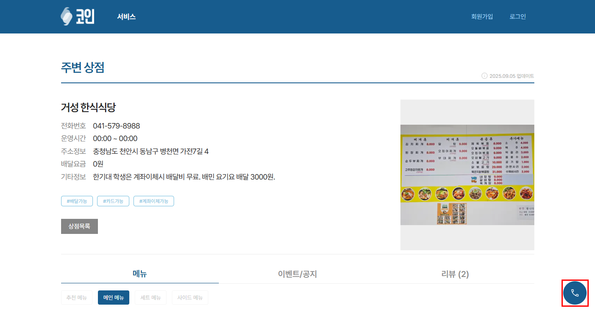

# 4-5 전화 주문 혜택 상점상세 전화 (클릭) 

원문 페이지 ID: 98a0221954bc836e8fcf01f13cefc418

> 원문 스냅샷. 명세 확정·앱 배포·수집 완료를 뜻하지 않습니다.

## 원문 속성

```json
{
  "platform": [
    "WEB",
    "ANDROID",
    "IOS"
  ],
  "url": "source-page-id:98a0221954bc836e8fcf01f13cefc418",
  "상태": "완료",
  "생성일": "2026-11-12T05:07:36.248Z",
  "이벤트 이름": "<p>\n4-5 전화 주문 혜택 상점상세 전화 (클릭) \n</p>",
  "태그": [
    "4. 혜택 페이지"
  ]
}
```

<details>
<summary>과거 로깅</summary>

<span color="orange">event\_params.key</span>

<ul>
<li>
event\_label : benefit\_shop\_call
</li>
<li>
value : \{상점이름\} 
</li>
<li>
event\_category : click
</li>
</ul>


<ul>
<li>
duration\_time : 상점 상세페이지로 들어와서 전화를 하기까지 걸린시간. 
</li>
</ul>
</details>

<details>
<summary>새 로깅</summary>

- 설명: 전화 주문 혜택 화면을 거쳐 들어간 상점 상세 화면에서 전화 버튼을 클릭하는 경우
- screen\_view: <code>shop_detail</code>
- event\_name: <code>DA1</code>
- event\_label: <code>shop__shop_detail__contact__phone__click</code>
- value: \{상점이름\} (예: 복지관 매점)
- event\_category: <code>click</code>

### 참고사진 (혜택 경유 상점 상세 전화)

<columns>
<column ratio="50">
<b>웹</b>

<b>참고사진 · 웹</b>

웹 — 오른쪽 아래 전화 버튼 클릭 (출처: stage 실제 캡처, 빨간 네모 = 클릭 위치)


</column>
<column ratio="50">
<b>모바일</b>

<b>참고사진 · 모바일</b>

파란색 구버전 모바일 사진 제거 (2026-10-30).
</column>
</columns>
</details>
