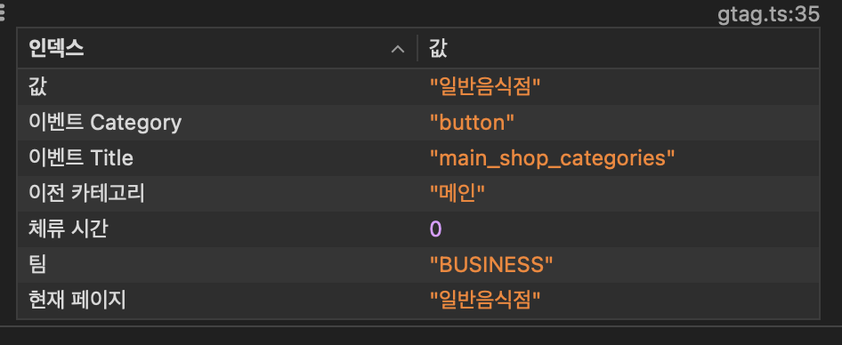

# 해결 

원문 페이지 ID: 98b0221954bc82e9a1cc014e8450ac86

> 원문 스냅샷. 명세 확정·앱 배포·수집 완료를 뜻하지 않습니다.

## 원문 속성

```json
{
  "title": "<p>\n해결 \n</p>"
}
```


<p>
웹 : 
</p>

<p>
주변상점에서 메인페이지로 나갔다가 들어온 뒤 카테고리를 누르면 체류 시간이 0 혹은 1로 나오는 이슈 
</p>




<p>
→ 뒤로가기를 한 뒤 다시 들어와도 시간이 찍히게 바꿔주시면 감사하겠습니다. 
</p>


---


<p>
안드로이드 : 
</p>

<p>
시간 : ms → S 
</p>
