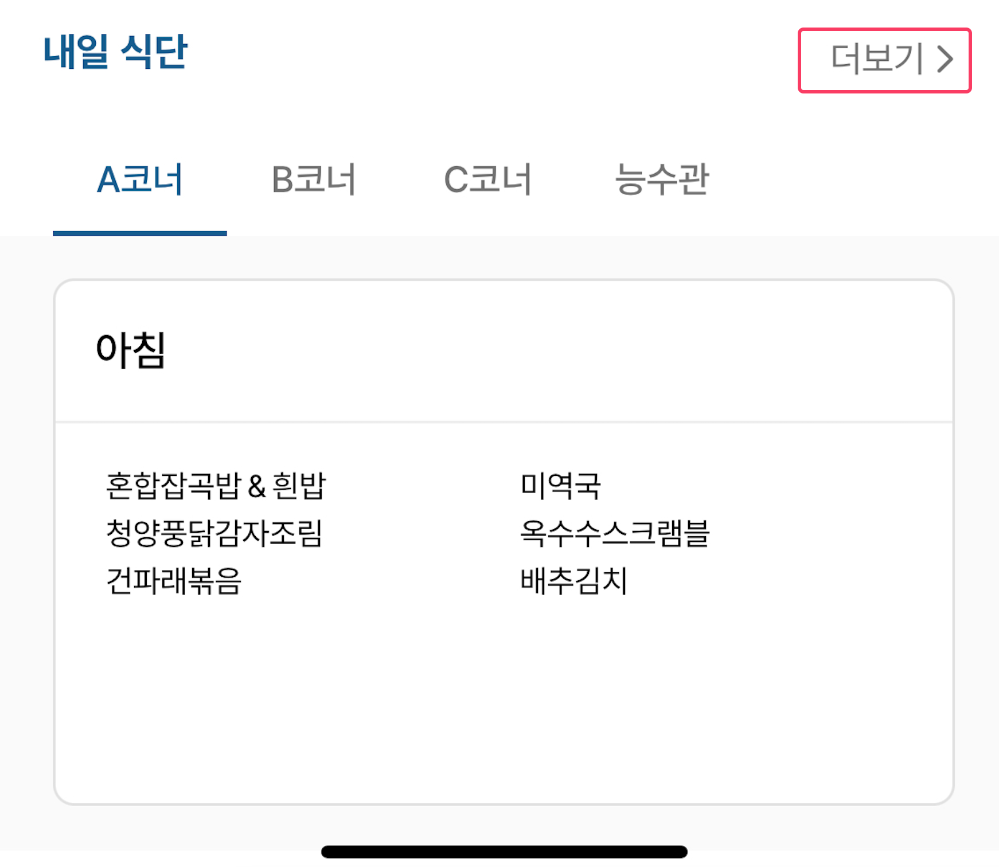
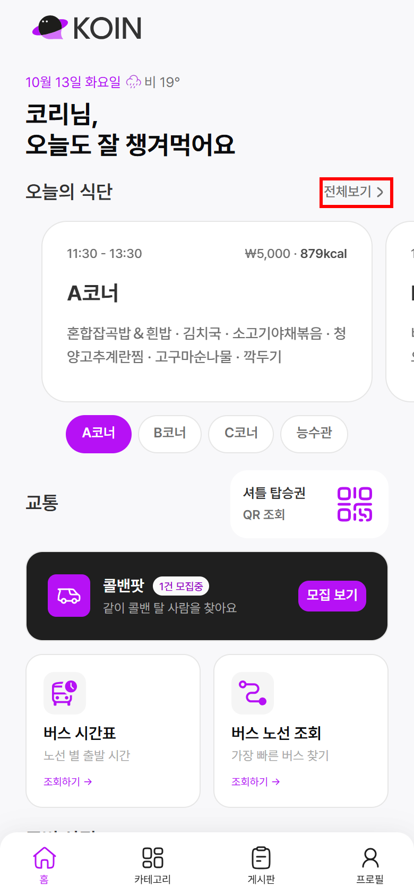

# [레거시] 메인_식단_더보기버튼_클릭(확인필요)

원문 페이지 ID: 9990221954bc832e91d3018d74d3477a

> 누락 원본 복구 스냅샷. 원본의 과거값·검토 기록을 보존하며 생성 계약으로 자동 승인하지 않습니다.

대조 기록: [87개 원본 복구 및 8개 차이 정리](../recovery-review.md)

관련 기존 보관본: [레거시 메인_식단_더보기버튼_클릭(확인필요)](3d50221954bc8228a8ed81c51f8aa5d6.md)

## 원문 속성

```json
{
  "platform": [
    "ANDROID",
    "IOS"
  ],
  "url": "source-page-id:9990221954bc832e91d3018d74d3477a",
  "상태": "진행 중",
  "생성일": "2026-11-08T10:51:34.702Z",
  "이름": "\\[레거시\\] 메인\\_식단\\_더보기버튼\\_클릭(확인필요)",
  "태그": [
    "1. 메인_식단"
  ]
}
```

<b>레거시·참조 명세 — 별도 구현 대상 아님</b>

- 2026-11-04 사용자 요청에 따라 중복·참조 관계를 정리했다. 식단 더보기의 현행 대표 명세는 [1-3 오늘의 식단 전체보기 클릭](2430221954bc839da344811d15eaa112.md)이며 적용 라벨은 <code>main__main__more__click</code>이다.
- 이 문서의 이전 label·value·category·event\_name·사진·플랫폼은 이력으로 보존한다. 아래 과거 ‘기준 명세’·‘별개 유지’ 설명보다 이 결정이 우선한다. 이 페이지를 근거로 이벤트를 추가 전송하지 않는다.
- 실제 SDK의 과거 호출 중단·새 라벨 전환·단일 전송은 개발 검증이 필요하다. 이 DB에는 레거시 상태 옵션이 없어 공용 옵션을 새로 만들지 않고 제목·본문으로 레거시를 표시했다.


<details>
<summary>이전 로깅</summary>


- event\_label : “main\_menu\_more”
- value : “더보기<b>”</b>
- event\_category : “click”
- 참고사진





</details>


<details>
<summary>이관 전 새 로깅 (26.10.17) — 레거시 보존</summary>


- 설명: 메인 화면의 식단 영역에서 더보기 버튼을 눌러 식단 화면으로 들어가는 경우
- screen\_view: <code>main</code>
- event\_name: <code>DA1</code>
- event\_label: <code>cafeteria__main__more__click</code>
- value: \{아침, 점심, 저녁\}\_더보기 (예: 점심\_더보기)
- event\_category: <code>click</code>

<details>
<summary>검토사항</summary>


- 통합 가이드·후속: [로깅 통합 가이드](3c30221954bc8214b1c481c5bbb6fba5.md)
- 참고: 1-1과 같은 로깅(중복 페이지). 1-1 기준으로 관리한다.
- 명세 중복 정리 (2026-10-27): <code>cafeteria__main__more__click</code>의 기준 명세는 [1-1.메인_식단_더보기버튼_클릭 (홈화면 리디자인 로깅으로 찍히고 있음) → 따라서  1-1부터 1-7까지 전부 다 수정할 필요 없음 (레거시)](3df0221954bc833a9f6381766084d23b.md). 기존 1-1의 같은 더보기 이벤트를 설명하는 중복 참고 명세다. 같은 사용자 동작은 한 번만 전송하며, 문서가 여러 개라는 이유로 추가 이벤트를 보내지 않는다. 기존 value·플랫폼·발생 시점은 유지한다.

</details>


### 참고사진 (메인 식단 더보기 클릭)


<b>웹</b>

<details>
<summary>참고사진 · 웹</summary>


해당 없음 (DB platform: 앱 전용)

</details>


<b>모바일</b>

<details>
<summary>참고사진 · 모바일</summary>


모바일 — 메인 식단 더보기 클릭 (출처: stage 실제 캡처, 빨간 네모 = 클릭 위치)





</details>


</details>
