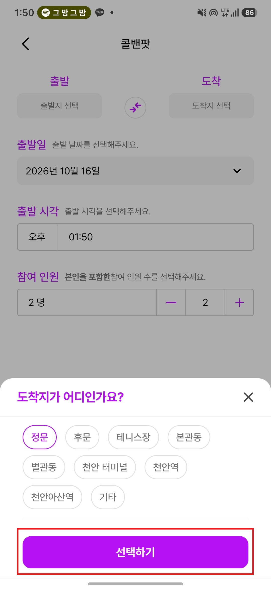

# 3-2 콜밴팟 도착지 선택

원문 페이지 ID: 99b0221954bc82af996e01beb7f602d0

> 사용자 제공 ZIP 내보내기 보관본. 레거시·동결·검토 상태는 원문을 따르며 코드 생성 승인·앱 배포 완료를 뜻하지 않습니다.

태그: 3. 콜밴팟 모집
platform: ANDROID, IOS
상태: 로깅 필요

- 이전 로깅
    
    
    - event_name : CAMPUS
    - event_category : click
    - event_label : callvan_write_arrival
    - value :
        - 예시 : 교내, 정문
        - 예시 : 교외, 천안 터미널
        - 예시 : 교내, 기타, 인문경영관
    
    
    
- 새 로깅 (2026-10-14) — 초안
    - 설명: 모집글 작성 화면 위 도착지 선택 바텀시트에서 장소를 선택하고 선택하기를 클릭한다.
    - screen_view: `callvan_write`
    - event_label: `callvan__callvan_write__callvan_write__arrival_confirm__click`
    - event_name: `DA2`
    - value: - 예시 : 교내, 정문
    - 예시 : 교외, 천안 터미널
    - 예시 : 교내, 기타, 인문경영관
    - event_category: `click`
    - 검토사항
        - 통합 가이드·후속: [로깅 통합 가이드](3c30221954bc8214b1c481c5bbb6fba5.md)
        - label 통일 (2026-10-27): callvan__callvan_write__callvan_write__arrival_confirm → callvan__callvan_write__callvan_write__arrival_confirm__click
        - 확정 (2026-10-16): 도착지 바텀시트의 ‘선택하기’ 버튼을 누르는 순간 최종 선택 장소를 전송한다. 개별 장소를 고르는 중에는 전송하지 않는다. 기존 장소 value와 category는 유지한다.
        - 도착지 참고사진은 사용자가 실제 화면으로 교체 완료했다(2026-10-16). 현재 첨부 이미지를 유지한다.
    
    ### 참고사진 (기능 표시)
    
    **모바일 (ANDROID, IOS) / 캡처 출처는 아래 참조**
    
    - 참고사진 · 모바일
        
        
