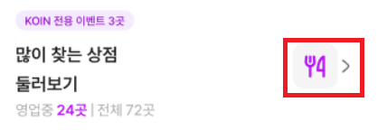
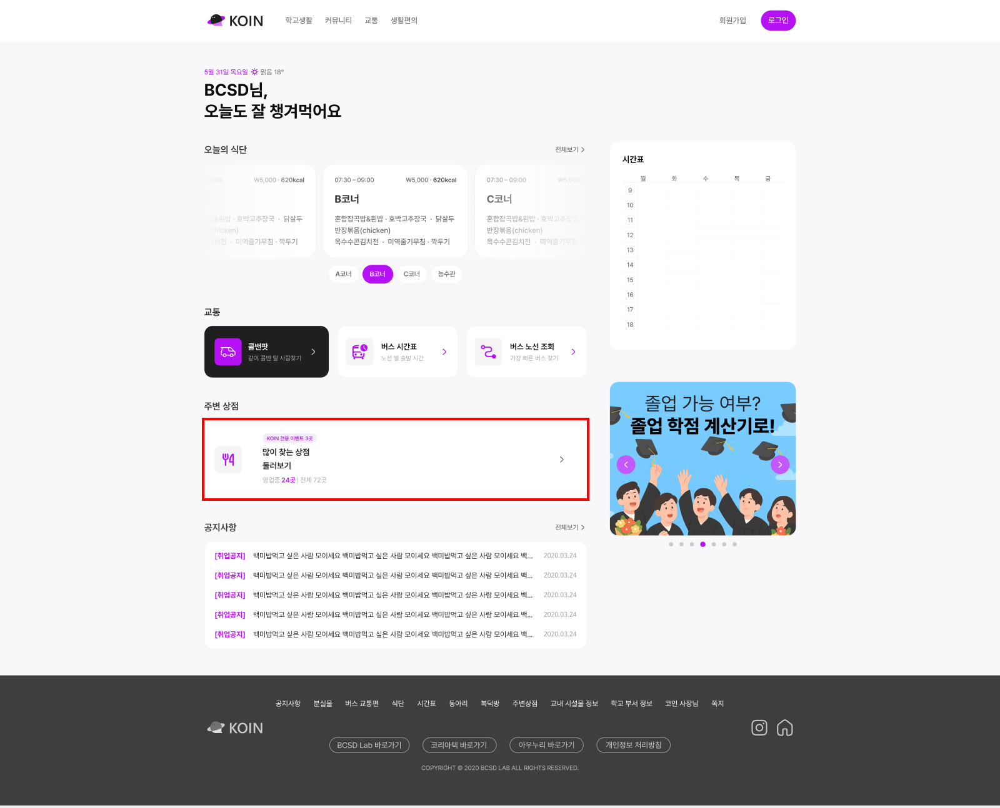
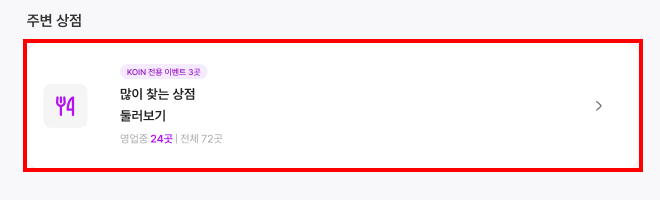

# 1-10 많이 찾는 상점 둘러보기 클릭

원문 페이지 ID: 99f0221954bc83b6816881eda6dc0be4

> 원문 스냅샷. 명세 확정·앱 배포·수집 완료를 뜻하지 않습니다.

## 원문 속성

```json
{
  "platform": [
    "ANDROID",
    "IOS",
    "WEB"
  ],
  "url": "source-page-id:99f0221954bc83b6816881eda6dc0be4",
  "구분": "홈화면",
  "상태": "완료",
  "생성일": "2026-11-08T10:52:02.264Z",
  "이벤트 이름": "1-10 많이 찾는 상점 둘러보기 클릭"
}
```

<details>
<summary>이전 로깅</summary>

- event\_label : popular\_shop
- value : 많이 찾는 상점 둘러보기
- event\_category : click





</details>

<details>
<summary>새 로깅 (26.11.01)</summary>

<b>많이 찾는 상점 둘러보기</b>

- 설명: 메인 화면의 많이 찾는 상점 둘러보기 버튼을 클릭할 때 기록한다. 주변상점 제목·전체보기 및 개별 카테고리 카드 클릭과 구분한다.
- screen\_view: <code>main</code>
- event\_name: <code>DA2</code>
- event\_label: <code>shop__main__shop_entry__popular_entry__click</code>
- value: 많이 찾는 상점 둘러보기
- event\_category: <code>click</code>

<details>
<summary>검토사항</summary>

- WEB 사진 기준 정리 (2026-11-04 사용자 지시): 새 로깅의 WEB 참고사진에는 리디자인 시안만 둔다. 구디자인 WEB 사진은 이전 로깅 이력으로 이동했다. 리디자인에서 버튼이 확인되지 않으면 사진 없이 미확인으로 표시한다. 라벨·value·category·event\_name·screen\_view·플랫폼과 모바일 사진은 유지한다.
- WEB 참고사진 반영 (2026-11-04 사용자 요청 정정): 아래 새 WEB 캡처와 빨간 네모·확대본을 기준으로 클릭 위치를 확인한다. 리디자인 전 WEB 사진은 이력으로 보존하며 모바일 사진·명세와 이전 로깅은 유지한다.
- WEB 리디자인 반영 (2026-11-04 사용자 승인): WEB: 홈 ‘주변 상점’ 영역의 ‘많이 찾는 상점 둘러보기’ 카드(영업 중 상점 수 표시)를 클릭할 때 기존 새 명세를 적용한다. 카드 노출·영업 중 상점 수 자체는 클릭 이벤트가 아니다. 1-9 전체보기와 중복 전송하지 않는다.
- WEB 설계 근거: [Figma 참고 / 실제 화면 미확인](https://www.figma.com/design/DPlcYuiFxhyT5ULbqec59i/KOIN-Web?node-id=11541-33352). 기존 사진은 교체하지 않았으며 리디자인 화면의 위치 근거로 사용하지 않는다. SDK 구현·배포 시점·실제 수집은 미확인이다. 이 WEB 규정은 해당 화면의 과거 WEB 설명보다 우선하며 모바일·이전 로깅·기존 필드 값·DB 플랫폼 속성은 보존한다.
- 사용자 승인 (2026-11-01): 기존 동작을 공통 네이밍 형식으로 정리하고 새 명세의 event\_name을 DA2로 통일했다. 기존 CAMPUS 지시와 과거 label·value·category·사진은 위 원문에 보존한다. 새 사용자 동작이나 추가 전송을 만드는 작업이 아니다.
- 이전 → 새 label: <code>popular_shop</code> → <code>shop__main__shop_entry__popular_entry__click</code>.
- 기존 click category·고정 value·선택값 의미·클릭 시점을 유지한다. 기존 DB 플랫폼 속성을 보존했으며, 실제 지원 플랫폼·SDK 적용·배포·한 번 전송은 미확인이다.
- 참고사진은 위 기존 사진을 그대로 참조한다. 이 작업에서 촬영·교체·플랫폼 재분류하지 않았다.
- 기준: [로깅 통합 가이드](3c30221954bc8214b1c481c5bbb6fba5.md), [event_label 기능·행동 네이밍 사전](38b0221954bc831b912c012d8af2c857.md), [화면 정의 및 로깅 검수](0e40221954bc823d92c301f83b5f68d0.md).
</details>

### 참고사진 (많이 찾는 상점 둘러보기 클릭)

<b>웹</b>

<details>
<summary>참고사진 · 웹</summary>

WEB 리디자인 · [Figma 시안](https://www.figma.com/design/DPlcYuiFxhyT5ULbqec59i/KOIN-Web?node-id=11541-33352) · 2026-11-04. 빨간 네모는 이 명세의 클릭 위치다. 원본 캡처에 코드로 테두리만 표시했으며 실제 서비스 캡처·배포 완료를 의미하지 않는다.

<b>전체 화면</b>



<b>클릭 위치 확대</b>


</details>

<b>모바일</b>

<details>
<summary>참고사진 · 모바일</summary>

이번 WEB 이미지 작업에서 별도 확인하지 않음. 기존 원문 사진과 모바일 명세는 그대로 보존한다.
</details>
</details>
