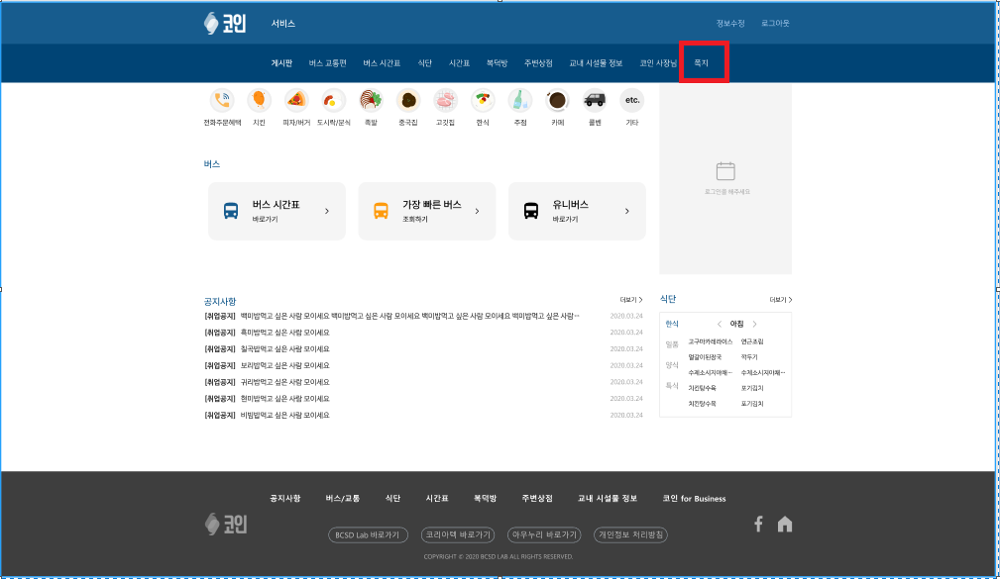

# 11-17.헤더_쪽지_클릭

원문 페이지 ID: 9a80221954bc834c98f601b8dcdc91a7

> 사용자 제공 ZIP 내보내기 보관본. 레거시·동결·검토 상태는 원문을 따르며 코드 생성 승인·앱 배포 완료를 뜻하지 않습니다.

platform: WEB
상태: 완료

- 설명:  웹 페이지 헤더 에서 쪽지 버튼 클릭
- event_label : “header”
- value : “쪽지”
- event_category : “click”
- 참고사진

WEB

- 검토사항
    - 후속 수정 (2026-10-27): ※ 옛 사본: 현행 명세는 게시판 DB의 같은 번호 페이지 [11-17.헤더_쪽지_클릭](84c0221954bc820392b5018ecce7d80a.md). 이 사본은 새 로깅이 없어 변환하지 않음.
