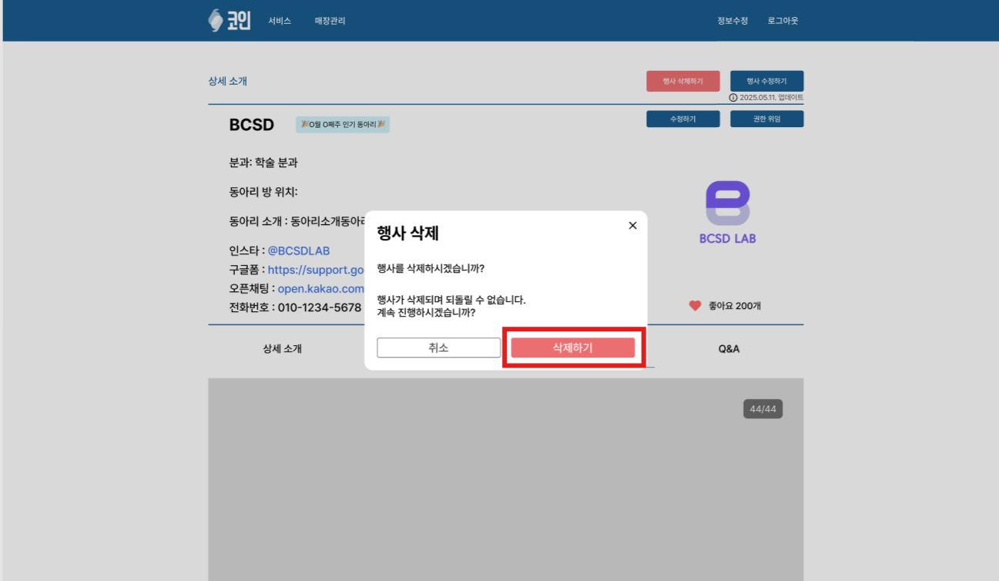

# 6.10동아리_행사삭제확정 클릭

원문 페이지 ID: 9b00221954bc833a8fac8154ff40d109

> 사용자 제공 ZIP 내보내기 보관본. 레거시·동결·검토 상태는 원문을 따르며 코드 생성 승인·앱 배포 완료를 뜻하지 않습니다.

platform: WEB
상태: 로깅 필요

- 설명: 동아리 행사 탭에서 행사 삭제 클릭 후 삭제하기 클릭
- event_name : “CAMPUS”
- event_label : “club_event_delete_confirm”
- value : {동아리명}
- event_category : “click”
- 참고사진
- 웹 참고사진

