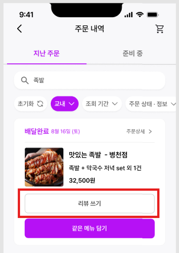

# 9-3 주문내역 검색창 리뷰쓰기

원문 페이지 ID: 9b10221954bc8219942881e2c34069cb

> 원문 스냅샷. 명세 확정·앱 배포·수집 완료를 뜻하지 않습니다.

## 원문 속성

```json
{
  "platform": [
    "ANDROID",
    "IOS"
  ],
  "url": "source-page-id:9b10221954bc8219942881e2c34069cb",
  "상태": "로깅 필요",
  "생성일": "2026-11-12T05:07:43.978Z",
  "이벤트 이름": "9-3 주문내역 검색창 리뷰쓰기"
}
```





<p>
검색창에서 텍스트 입력한 후 리뷰 쓰기 클릭 로깅입니다 
</p>


<span color="orange">event\_params.key</span>

<ul>
<li>
event\_label : orderHistory\_search\_review
</li>
<li>
value : 

- \{상점이름\}
</li>
<li>
event\_category : click
</li>
<li>
previous\_page :
</li>
<li>
current\_page :
</li>
<li>
duration\_time :
</li>
</ul>
