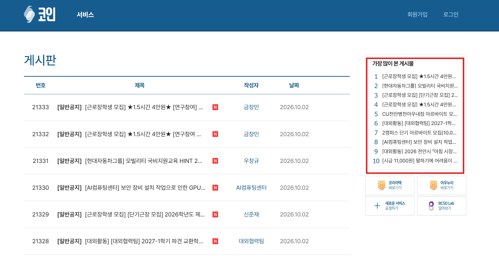

# 3-1. 공지사항_가장 많이 본 게시물_클릭

원문 페이지 ID: 9b30221954bc82ee8b3f0131e5765de0

> 원문 스냅샷. 명세 확정·앱 배포·수집 완료를 뜻하지 않습니다.

## 원문 속성

```json
{
  "platform": [
    "WEB"
  ],
  "url": "source-page-id:9b30221954bc82ee8b3f0131e5765de0",
  "상태": "로깅 필요",
  "이름": "3-1. 공지사항\\_가장 많이 본 게시물\\_클릭",
  "태그": [
    "3. 공지사항 상세 페이지"
  ]
}
```

<details>
<summary>과거 로깅</summary>

- 설명: 공지사항 페이지에서 가장 많이본 게시물 1\~10번중 클릭했을때
- event\_label : “notice\_hot”
- value : “”
- event\_category : “click”
- 참고사진


</details>

<details>
<summary>새 로깅</summary>

<ul>
<li>
설명: 공지사항 화면에서 가장 많이 본 게시물 영역의 게시글 클릭.
</li>
<li>
screen\_view: <code>main_notice</code>
</li>
<li>
event\_name: <code>DA2</code>
</li>
<li>
event\_label: <code>board__main_notice__notice_detail__popular_post_entry__click</code> 
</li>
<li>
value: \{공지ID\}

- ID가 안되면 공지제목으로 넣어주시면 감사하겠습니다! (조치 후 결과 아래에 남겨주세요)
</li>
<li>
event\_category: <code>click</code>
</li>
</ul>

<b>참고사진 · 웹</b>

<b>웹</b>


</details>
