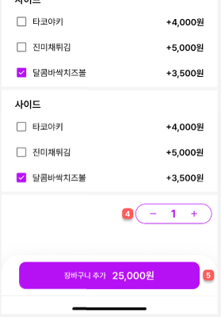

# 3-11 메뉴 선택 후 카트 추가 클릭

원문 페이지 ID: 9ba0221954bc833c827981a0c19598bf

> 원문 스냅샷. 명세 확정·앱 배포·수집 완료를 뜻하지 않습니다.

## 원문 속성

```json
{
  "platform": [
    "ANDROID",
    "IOS"
  ],
  "url": "source-page-id:9ba0221954bc833c827981a0c19598bf",
  "상태": "로깅 필요",
  "생성일": "2026-11-08T10:51:29.401Z",
  "이벤트 이름": "3-11 메뉴 선택 후 카트 추가 클릭",
  "태그": [
    "3. 상점 상세 페이지"
  ]
}
```




메뉴를 선택 후, 하단의 ‘장바구니 추가’를 클릭하는 로깅입니다.


<span color="orange">event\_params.key</span>

<ul>
<li>
event\_label : shop\_detail\_menu\_cart\_add
</li>
<li>
value : \{상점이름\} 
</li>
<li>
event\_category : 

<ul>
<li>
click 
</li>
</ul>
</li>
<li>
previous\_page : 메뉴
</li>
<li>
current\_page : 메뉴(장바구니 추가)
</li>
<li>
duration\_time : 메뉴에 진입하고 장바구니 추가까지 걸리는 시간
</li>
</ul>
