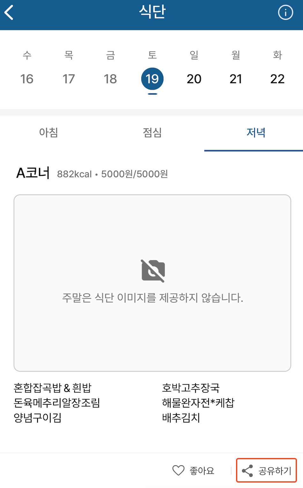

# 3-8. (Android / iOS) 식단_카카오톡_공유하기_클릭

원문 페이지 ID: 9bb0221954bc82f6b4e301a447d0894e

> 누락 원본 복구 스냅샷. 원본의 과거값·검토 기록을 보존하며 생성 계약으로 자동 승인하지 않습니다.

대조 기록: [87개 원본 복구 및 8개 차이 정리](../recovery-review.md)

관련 기존 보관본: [3-8. (Android / iOS) 식단_카카오톡_공유하기_클릭](9610221954bc82d09b750118aa5dc7aa.md)

## 원문 속성

```json
{
  "platform": [
    "ANDROID",
    "IOS"
  ],
  "url": "source-page-id:9bb0221954bc82f6b4e301a447d0894e",
  "상태": "완료",
  "생성일": "2026-11-08T10:51:35.479Z",
  "이름": "3-8. (Android / iOS) 식단\\_카카오톡\\_공유하기\\_클릭",
  "태그": [
    "3. 식단 상세페이지"
  ]
}
```

<details>
<summary>이전 로깅</summary>


- event\_label : “menu\_share”
- value : “공유하기<b>”</b>
- event\_category : “click”
- 참고사진





</details>


<details>
<summary>새 로깅 (26.10.17)</summary>


- 설명: 식단 화면에서 카카오톡 공유하기 버튼을 눌러 식단을 공유하는 경우 (식단 퍼널 마지막 단계)
- screen\_view: <code>cafeteria</code>
- event\_name: <code>DA1</code>
- event\_label: <code>cafeteria__cafeteria__share__kakao__click</code>
- value: 공유하기
- event\_category: <code>click</code>

<details>
<summary>검토사항</summary>


- 통합 가이드·후속: [로깅 통합 가이드](3c30221954bc8214b1c481c5bbb6fba5.md)
- 웹: 없음 (앱 전용)
- label DA2 기준 정렬 (2026-10-27): <code>cafeteria__cafeteria__share__click</code> → <code>cafeteria__cafeteria__share__kakao__click</code>

</details>


### 참고사진 (카카오톡 공유하기)


<b>웹</b>

<details>
<summary>참고사진 · 웹</summary>


해당 없음 (앱 전용)

</details>


<b>모바일</b>

<details>
<summary>참고사진 · 모바일</summary>


출처: 이 페이지 이전 로깅의 기존 앱 참고사진 사본. 표시 대상은 현행 설명과 대조했으며, 현행 앱의 화면·구현은 미검증입니다. 빨간 네모는 동작 대상입니다.

파란색 구버전 모바일 사진 제거 (2026-10-30).

</details>


</details>
