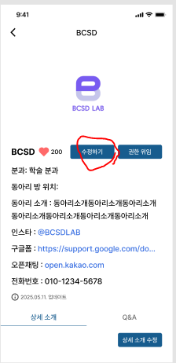
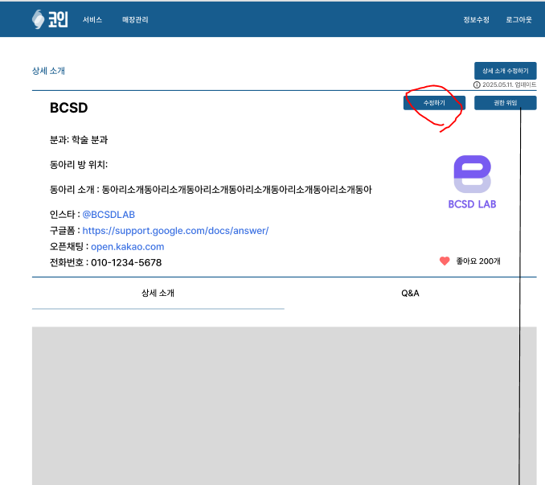

# 5-1.동아리_수정하기 클릭

원문 페이지 ID: 9d20221954bc82788c8f01374d2d0e97

> 필터 밖 원본 행 복구 스냅샷. 중복·빈 페이지도 원본 ID와 속성, 본문을 개별 보존합니다. 명세 승인이나 앱 적용 완료를 뜻하지 않습니다.

대조 기록: [숨겨진 원본 42개 복구](../hidden-recovery.md)

관련 기존 보관본: [레거시 5-1.동아리_수정하기 클릭](5320221954bc82a9a2fe812dffd3724a.md), [레거시 5-1.동아리_수정하기 클릭](c700221954bc8335bfec0135d56074d7.md)

## 원문 속성

```json
{
  "platform": [
    "ANDROID",
    "IOS",
    "WEB"
  ],
  "url": "source-page-id:9d20221954bc82788c8f01374d2d0e97",
  "상태": "완료",
  "이름": "5-1.동아리\\_수정하기 클릭"
}
```

<ul>
<li>
설명: 동아리 소개 화면에서 수정하기 버튼 클릭
</li>
<li>
event\_name : “CAMPUS”
</li>
<li>
event\_label : “club\_correction”
</li>
<li>
value : “수정하기”
</li>
<li>
event\_category : “click” 
</li>
<li>
참고사진
</li>
</ul>





- 웹 참고사진



