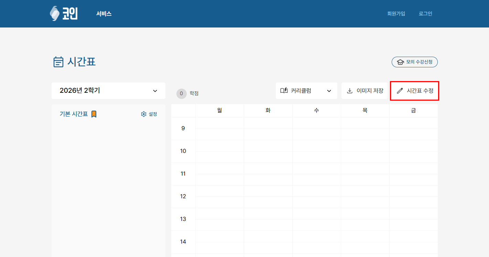
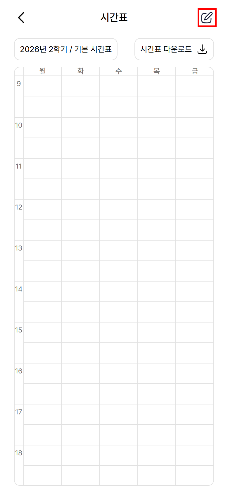

# 2-23. (웹, 반응형 앱) 시간표_시간표 수정 (클릭) - 추가된 로깅

원문 페이지 ID: 9e70221954bc83e08d4581dd8bc403b3

> 원문 스냅샷. 명세 확정·앱 배포·수집 완료를 뜻하지 않습니다.

## 원문 속성

```json
{
  "platform": [
    "ANDROID",
    "IOS",
    "WEB"
  ],
  "url": "source-page-id:9e70221954bc83e08d4581dd8bc403b3",
  "상태": "로깅 필요",
  "생성일": "2026-11-08T10:52:15.553Z",
  "이벤트 이름": "2-23. (웹, 반응형 앱) 시간표\\_시간표 수정 (클릭) - 추가된 로깅",
  "태그": [
    "시간표"
  ]
}
```

<details>
<summary>이전 로깅</summary>

- 없음 (새로 추가한 로깅)
</details>

<details>
<summary>새 로깅 (26.10.17)</summary>

- 설명: 시간표 화면에서 시간표 수정 버튼(모바일은 오른쪽 위 연필 아이콘)을 클릭해 시간표 수정 화면으로 들어가는 경우 (모바일은 'PC환경만 지원합니다' 안내가 뜨고 들어가지 않음)
- screen\_view: <code>timetable</code>
- event\_name: <code>DA1</code>
- event\_label: <code>timetable__timetable__timetable_edit__entry__click</code>
- value: 시간표 수정
- event\_category: <code>click</code>

<details>
<summary>검토사항</summary>

- label DA2 기준 정렬 (2026-10-27): <code>timetable__timetable__edit__click</code> → <code>timetable__timetable__timetable_edit__entry__click</code>
- 통합 가이드·후속: [로깅 통합 가이드](3c30221954bc8214b1c481c5bbb6fba5.md)
</details>

### 참고사진 (기능 표시)

<columns>
<column ratio="50">
<b>웹</b>

<details>
<summary>참고사진 · 웹</summary>

웹 — 시간표 수정 (출처: stage 실제 캡처, 빨간 네모 = 클릭 위치)


</details>
</column>
<column ratio="50">
<b>모바일</b>

<details>
<summary>참고사진 · 모바일</summary>

모바일 — 시간표 수정 (출처: stage 실제 캡처, 빨간 네모 = 클릭 위치)


</details>
</column>
</columns>
</details>
