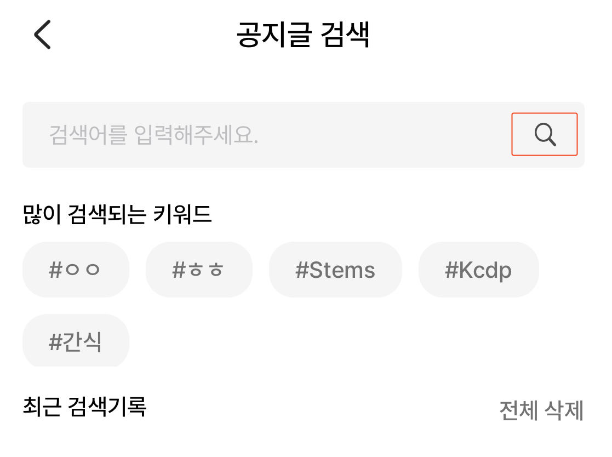
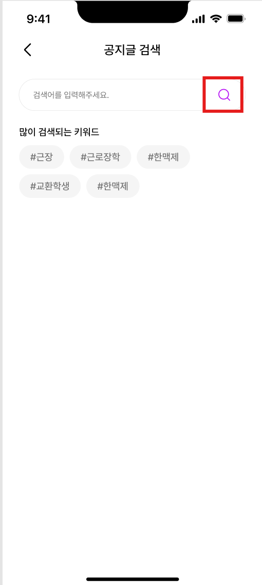

# 6-3. 공지글 검색_검색하기_클릭

원문 페이지 ID: 9ee0221954bc8247badd01d88c248db9

> 원문 스냅샷. 명세 확정·앱 배포·수집 완료를 뜻하지 않습니다.

## 원문 속성

```json
{
  "platform": [
    "ANDROID",
    "IOS"
  ],
  "url": "source-page-id:9ee0221954bc8247badd01d88c248db9",
  "상태": "로깅 필요",
  "이름": "6-3. 공지글 검색\\_검색하기\\_클릭",
  "태그": [
    "6. 공지글 검색(APP)"
  ]
}
```

<details>
<summary>이전 로깅</summary>

<ul>
<li>
설명 : 공지글 검색 페이지에서 <u>최종 검색 버튼 클릭</u>
</li>
<li>
<span color="yellow">주의사항</span> : Enter, 돋보기 버튼 모두 로깅
</li>
<li>
event\_label : “notice\_search\_event”
</li>
<li>
value : “검색하기”
</li>
<li>
event\_category : “click” 
</li>
<li>
참고사진


</li>
</ul>


</details>

<details>
<summary>새 로깅 (26.10.05) — 초안</summary>

- 설명: 공지글 검색 화면에서 최종 검색 실행.
- screen\_view: <code>notice_search</code>
- event\_name: <code>DA2</code>
- event\_label: <code>board__notice_search__search__submit</code>
- value: \{입력값\}
- event\_category: <code>submit</code>

<details>
<summary>검토사항</summary>

- 통합 가이드·후속: [로깅 통합 가이드](3c30221954bc8214b1c481c5bbb6fba5.md)
- 참고사항
  - Enter 키와 돋보기 버튼을 통한 검색을 모두 포함합니다.
- label 통일 (2026-10-27): <code>board__notice_search__search__search_submit</code> → <code>board__notice_search__search__submit</code>
</details>

<details>
<summary>참고사진 · 모바일</summary>

<b>모바일</b>


</details>
</details>
