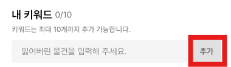
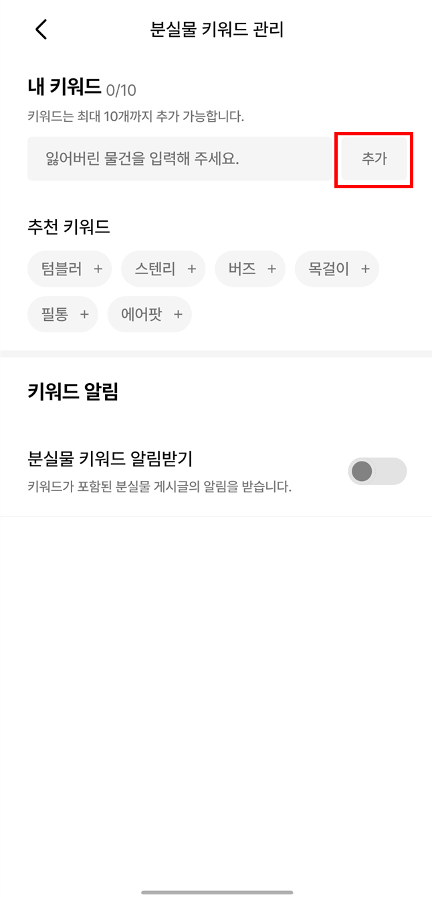

# 12-2. 키워드 추가_클릭

원문 페이지 ID: 9f10221954bc83f8933201d5150fce52

> 원문 스냅샷. 명세 확정·앱 배포·수집 완료를 뜻하지 않습니다.

## 원문 속성

```json
{
  "platform": [
    "ANDROID",
    "IOS"
  ],
  "url": "source-page-id:9f10221954bc83f8933201d5150fce52",
  "상태": "로깅 필요",
  "이름": "12-2. 키워드 추가\\_클릭",
  "태그": [
    "12. 분실물 키워드"
  ]
}
```

<details>
<summary>이전 로깅</summary>

- 설명: 내 키워드 추가 클릭
- event\_label: “lost\_item\_keyword\_add”
- value: “키워드 추가”
- event\_category: “click”
- 참고사진




</details>

<details>
<summary>새 로깅 (26.10.12) — 초안</summary>

- 설명: 입력한 키워드를 ‘추가’ 버튼으로 최종 추가한다.
- screen\_view: <code>lost_item_keyword_manage</code>
- event\_name: <code>DA2</code>
- event\_label: <code>board__lost_item_keyword_manage__keyword_manage__add__submit</code>
- value: <code>{추가 버튼 클릭 시 입력된 키워드}</code> — 동적 STRING. 버튼을 누른 시점에 최종 추가하는 키워드 문자열을 저장한다.
- event\_category: <code>submit</code>

<details>
<summary>검토사항</summary>

- 통합 가이드·후속: [로깅 통합 가이드](3c30221954bc8214b1c481c5bbb6fba5.md)
- label 통일 (2026-10-27): <code>board__lost_item_keyword_manage__keyword_manage__add_submit</code> → <code>board__lost_item_keyword_manage__keyword_manage__add__submit</code>
- 확정 (2026-10-16): ‘추가’ 버튼 클릭 순간에 입력 키워드를 value로 전송한다. 입력창 열기·타이핑 중·서버 성공 응답 시점과 구분한다.
</details>

### 참고사진 (기능 표시)

<columns>
<column ratio="50">
<b>웹</b>

화면 정의에 웹 화면 없음.
</column>
<column ratio="50">
<b>모바일</b>

<details>
<summary>참고사진 · 모바일</summary>

모바일 — 내 키워드 추가


</details>
</column>
</columns>
</details>
