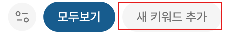

# 7-3. 새 키워드 추가_클릭

원문 페이지 ID: 9f20221954bc82f29d99013b23a78bb6

> 원문 스냅샷. 명세 확정·앱 배포·수집 완료를 뜻하지 않습니다.

## 원문 속성

```json
{
  "platform": [
    "ANDROID",
    "IOS"
  ],
  "url": "source-page-id:9f20221954bc82f29d99013b23a78bb6",
  "상태": "레거시",
  "이름": "7-3. 새 키워드 추가\\_클릭",
  "태그": [
    "7. 키워드 관리(APP)"
  ]
}
```

<details>
<summary>이전 로깅</summary>




</details>

<details>
<summary>새 로깅 (26.10.05) — 초안</summary>

- 설명: 공지사항 목록의 새 키워드 추가 버튼 클릭.
- screen\_view:
- event\_name: <code>DA1</code>
- event\_label: <code>board__notice_list__keyword_manage__add_entry</code>
- value: “새 키워드 추가”
- event\_category: <code>click</code>
- 적용 플랫폼: ANDROID, IOS
- 참고사항
  - 관리 화면 진입을 기록하는 항목이며, 키워드 입력값의 실제 저장은 7-4와 구분합니다.
- 참고사진: 이전 로깅의 참고사진 참조
</details>

레거시 사유: 7-1. 키워드 관리\_클릭에 병합
