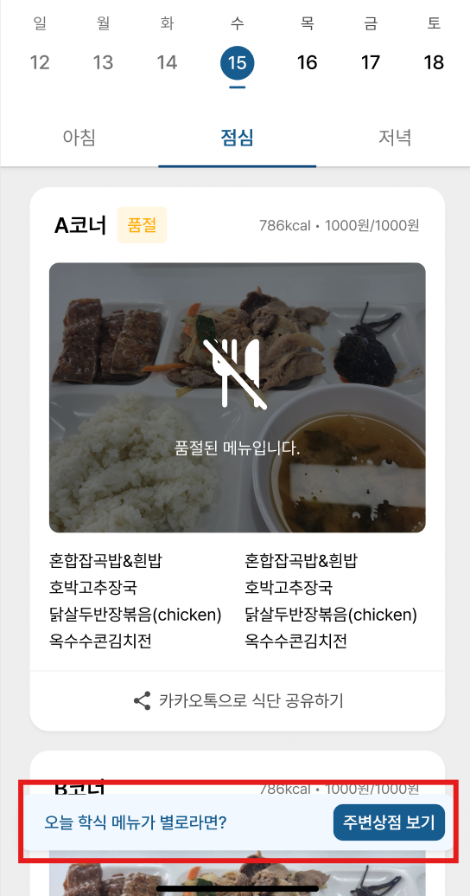

# 0-1. 식단_ABtest_상점가기_클릭 - 레거시

원문 페이지 ID: 9fa0221954bc823d9b0501dbafc5b3d1

> 원문 스냅샷. 명세 확정·앱 배포·수집 완료를 뜻하지 않습니다.

## 원문 속성

```json
{
  "platform": [
    "ANDROID",
    "IOS",
    "WEB"
  ],
  "url": "source-page-id:9fa0221954bc823d9b0501dbafc5b3d1",
  "상태": "완료",
  "생성일": "2026-11-12T05:07:50.101Z",
  "이름": "0-1. 식단\\_ABtest\\_상점가기\\_클릭 - 레거시",
  "태그": [
    "0. A/B TEST"
  ]
}
```

<details>
<summary>과거 로깅</summary>

- event\_label : “dining\_to\_shop”
- value : “\{아침 or 점심 or 저녁\}<b>”</b>
- event\_category : “click”
- 설명: 학식 화면에서 상점 화면으로 가는 버튼 클릭 시 발생하는 이벤트입니다.
- custom\_session\_id : \{dining2shop\}\_\{0\}\_\{플랫폼\}\_\{세션시작시간\}\_\{랜덤값\}
- 참고사진


</details>
