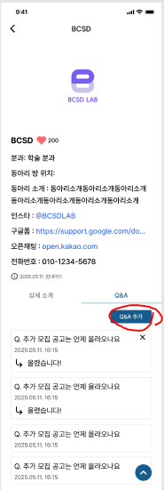

# 4-1. 동아리_Q&A추가

원문 페이지 ID: a030221954bc83c08e848103b436bf57

> 사용자 제공 ZIP 내보내기 보관본. 레거시·동결·검토 상태는 원문을 따르며 코드 생성 승인·앱 배포 완료를 뜻하지 않습니다.

platform: ANDROID, IOS
상태: 완료

- 설명: 동아리 상세 화면 에서 Q&A 추가 클릭
- event_name : “CAMPUS”
- event_label : “club_Q&A_add”
- value : “Q&A”
- event_category : “click”
- 참고사진

