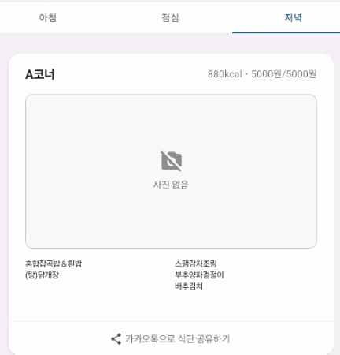

# 3-6. 식단_저녁_스크롤

원문 페이지 ID: a230221954bc8369b994016a3caafcaf

> 원문 스냅샷. 명세 확정·앱 배포·수집 완료를 뜻하지 않습니다.

## 원문 속성

```json
{
  "platform": [
    "ANDROID",
    "IOS",
    "WEB"
  ],
  "url": "source-page-id:a230221954bc8369b994016a3caafcaf",
  "상태": "완료",
  "생성일": "2026-11-12T05:07:50.962Z",
  "이름": "3-6. 식단\\_저녁\\_스크롤",
  "태그": [
    "3. 식단 상세페이지"
  ]
}
```

<details>
<summary>과거 로깅</summary>

- 설명 : 식단 페이지에서 저녁 식사 부분에서 스크롤
- event\_label : “menu\_time”
- value : “저녁<b>”</b>
- event\_category : “scroll”
- 참고사진


</details>

<details>
<summary>새 로깅</summary>

- 레거시: 3-4로 통합. 새 로깅을 만들지 않는다.
- 대체 로깅 : 3-4 (cafeteria\_\_cafeteria\_\_meal\_time\_\_scroll)

### 참고사진 (레거시)

<columns>
<column ratio="50">
<b>웹</b>

<b>참고사진 · 웹</b>

해당 없음 (레거시)
</column>
<column ratio="50">
<b>모바일</b>

<b>참고사진 · 모바일</b>

해당 없음 (레거시)
</column>
</columns>
</details>
