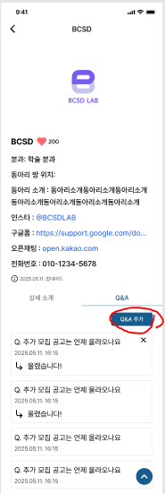

# 4-1. 동아리_Q&A추가

원문 페이지 ID: a260221954bc8353b7b38155f131c036

> 필터 밖 원본 행 복구 스냅샷. 중복·빈 페이지도 원본 ID와 속성, 본문을 개별 보존합니다. 명세 승인이나 앱 적용 완료를 뜻하지 않습니다.

대조 기록: [숨겨진 원본 42개 복구](../hidden-recovery.md)

관련 기존 보관본: [레거시 4-1. 동아리_Q&A추가](5770221954bc8248a7fc8179fb1f07bd.md), [레거시 4-1. 동아리_Q&A추가](8bd0221954bc837b8e9481b564468dc9.md)

## 원문 속성

```json
{
  "platform": [
    "ANDROID",
    "IOS"
  ],
  "url": "source-page-id:a260221954bc8353b7b38155f131c036",
  "상태": "완료",
  "이름": "4-1. 동아리\\_Q&A추가"
}
```

<ul>
<li>
설명: 동아리 상세 화면 에서 Q&A 추가 클릭
</li>
<li>
event\_name : “CAMPUS”
</li>
<li>
event\_label : “club\_Q&A\_add”
</li>
<li>
value : “Q&A”
</li>
<li>
event\_category : “click” 
</li>
<li>
참고사진
</li>
</ul>



