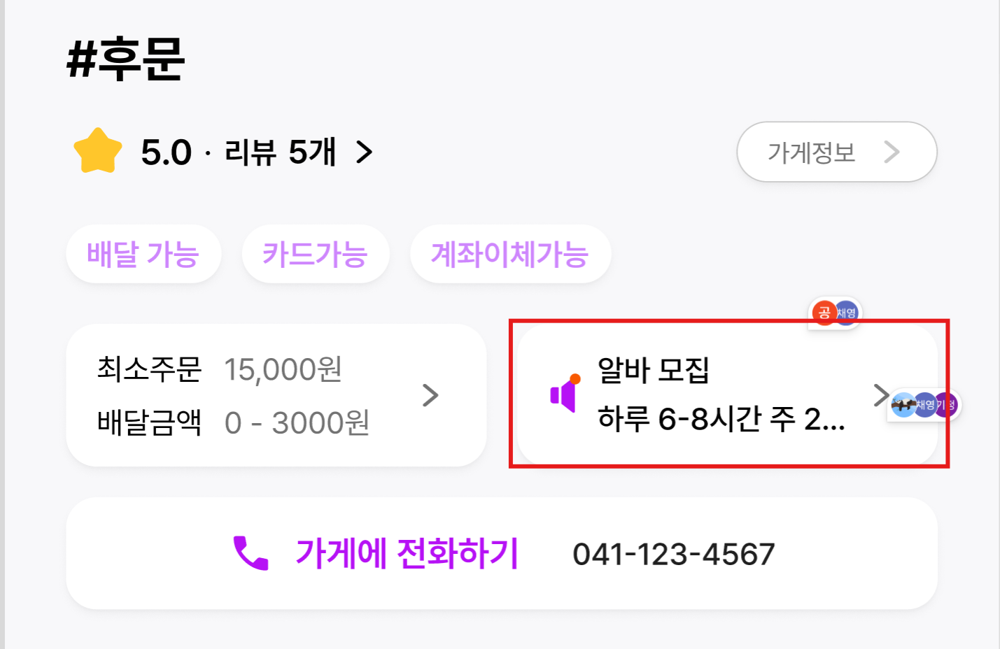

# 5.0 혜택 페이지 진입

원문 페이지 ID: a310221954bc8230a71701121cc9bc52

> 원문 스냅샷. 명세 확정·앱 배포·수집 완료를 뜻하지 않습니다.

## 원문 속성

```json
{
  "platform": [
    "ANDROID",
    "IOS",
    "WEB"
  ],
  "url": "source-page-id:a310221954bc8230a71701121cc9bc52",
  "상태": "로깅 필요",
  "생성일": "2026-11-12T05:07:41.627Z",
  "이벤트 이름": "5.0 혜택 페이지 진입",
  "태그": [
    "5. 새 혜택페이지"
  ]
}
```

<callout icon="❗">
기존 로깅이 존재해서 아래 적힌 새 로깅으로 변경해주시면 되겠습니다
</callout>

<details>
<summary>기존 로깅</summary>

event\_params.key

- event\_label : shop\_detail\_view\_info
- value : \{상점이름\}
- event\_category :
  - click
</details>

<span color="orange">event\_params.key</span>

<ul>
<li>
event\_label : shop\_benefit\_entry
</li>
<li>
value : \{상점이름\} 
</li>
<li>
event\_category : 

<ul>
<li>
click 
</li>
</ul>
</li>
<li>
사진
</li>
</ul>


