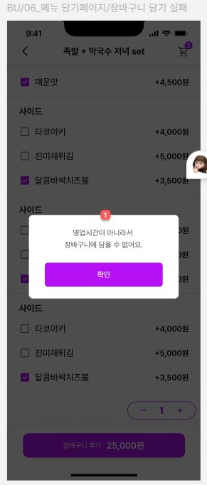

# 3-12 영업시간으로 인한 카트 추가 실패

원문 페이지 ID: a3f0221954bc8351b75681c9e6a8a9d3

> 원문 스냅샷. 명세 확정·앱 배포·수집 완료를 뜻하지 않습니다.

## 원문 속성

```json
{
  "platform": [
    "ANDROID",
    "IOS"
  ],
  "url": "source-page-id:a3f0221954bc8351b75681c9e6a8a9d3",
  "상태": "로깅 필요",
  "생성일": "2026-11-12T05:07:45.852Z",
  "이벤트 이름": "3-12 영업시간으로 인한 카트 추가 실패",
  "태그": [
    "3. 상점 상세 페이지"
  ]
}
```



<span color="orange">event\_params.key</span>

<ul>
<li>
event\_label : shop\_detail\_menu\_addFail
</li>
<li>
value : \{상점이름\} 
</li>
<li>
event\_category : 

<ul>
<li>
click 
</li>
</ul>
</li>
</ul>
