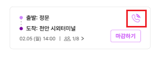
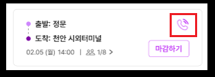

# 2-8  콜밴팟 전화 클릭

원문 페이지 ID: a410221954bc835c9ef30174af0f8513

> 원문 스냅샷. 명세 확정·앱 배포·수집 완료를 뜻하지 않습니다.

## 원문 속성

```json
{
  "platform": [
    "ANDROID",
    "IOS"
  ],
  "url": "source-page-id:a410221954bc835c9ef30174af0f8513",
  "상태": "로깅 필요",
  "이름": "2-8  콜밴팟 전화 클릭",
  "태그": [
    "2. 콜밴팟 찾기"
  ]
}
```

<details>
<summary>과거 로깅</summary>

콜밴 모집자 화면 기준 로깅입니다.


<ul>
<li>
event\_name : CAMPUS
</li>
<li>
event\_category : click
</li>
<li>
event\_label : callvan\_call
</li>
<li>
value : 
</li>
</ul>





</details>

<details>
<summary>새 로깅</summary>

- 설명: 콜밴 모집자 기준으로 목록의 팟 카드 전화 아이콘을 클릭한다.
- screen\_view: <code>callvan_list</code>
- event\_label: <code>callvan__callvan_list__contact__phone__click</code>
- event\_name: <code>DA2</code>
- value: 기존 미기재 유지
- event\_category: <code>click</code>

### 참고사진 (기능 표시)

<b>모바일 (ANDROID, IOS) / 캡처 출처는 아래 참조</b>

<b>참고사진 · 모바일</b>

최근 모바일 캡처 사본. 사용자 재확인 (2026-10-16): 현재 앱과 동일한 모집자 팟 카드. 에이전트의 추가 실기기·수집 검수는 별도.


</details>
