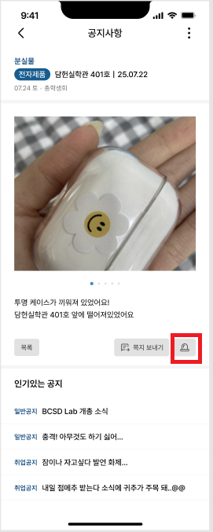
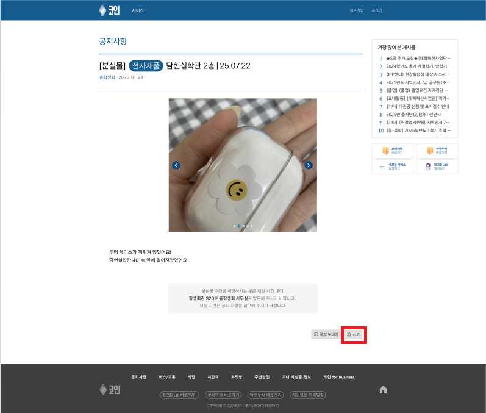
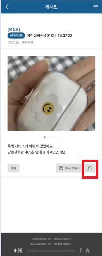

# 11-13.분실물_신고하기_클릭

원문 페이지 ID: a460221954bc828aad4e81e89cdd8a62

> 누락 원본 복구 스냅샷. 원본의 과거값·검토 기록을 보존하며 생성 계약으로 자동 승인하지 않습니다.

대조 기록: [87개 원본 복구 및 8개 차이 정리](../recovery-review.md)

관련 기존 보관본: [11-13.분실물_신고하기_클릭](a190221954bc82e2afc801bed93a741d.md), [11-13.분실물_신고하기_클릭](c050221954bc821db0610121570a8c2c.md)

## 원문 속성

```json
{
  "platform": [
    "ANDROID",
    "IOS",
    "WEB"
  ],
  "url": "source-page-id:a460221954bc828aad4e81e89cdd8a62",
  "상태": "완료",
  "이름": "11-13.분실물\\_신고하기\\_클릭"
}
```

- 설명:  게시글에서 신고하기 버튼 클릭
- event\_label : “item\_post\_report”
- value : “신고하기”
- event\_category : “click”
- 참고사진

mobile\_view





WEB





mobile\_Web\_view



