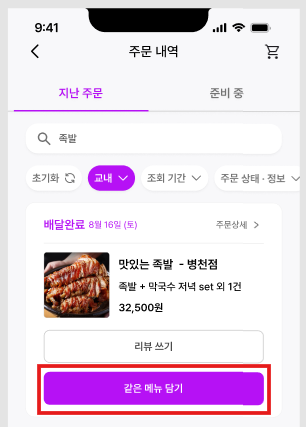

# 9-4 주문내역 검색창 같은 메뉴 담기

원문 페이지 ID: a610221954bc826c9fa6017371b41500

> 원문 스냅샷. 명세 확정·앱 배포·수집 완료를 뜻하지 않습니다.

## 원문 속성

```json
{
  "platform": [
    "ANDROID",
    "IOS"
  ],
  "url": "source-page-id:a610221954bc826c9fa6017371b41500",
  "상태": "로깅 필요",
  "생성일": "2026-11-12T05:07:47.913Z",
  "이벤트 이름": "9-4 주문내역 검색창 같은 메뉴 담기",
  "태그": [
    "9. 주문내역 페이지"
  ]
}
```





검색창에서 텍스트 입력 후 같은 메뉴 담기 버튼 클릭 로깅입니다


<span color="orange">event\_params.key</span>

<ul>
<li>
event\_label : orderHistory\_search\_menuAdd
</li>
<li>
value : 

- \{상점이름\}
</li>
<li>
event\_category : click
</li>
<li>
previous\_page :
</li>
<li>
current\_page :
</li>
<li>
duration\_time :
</li>
</ul>
