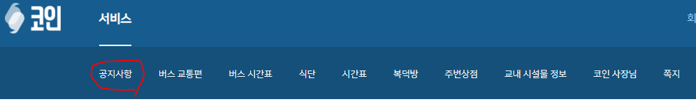

# 2-1. 헤더_공지사항_클릭

원문 페이지 ID: a690221954bc82d2b88e81201d92a366

> 사용자 제공 ZIP 내보내기 보관본. 레거시·동결·검토 상태는 원문을 따르며 코드 생성 승인·앱 배포 완료를 뜻하지 않습니다.

platform: WEB
상태: 완료

- 설명: 헤더 에서 공지사항 클릭
- event_label : “header”
- value : “공지사항”
- event_category : “click”
- 참고사진

