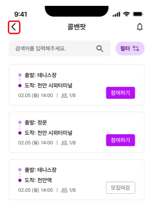

# 2-11  콜밴팟 찾기 이탈

원문 페이지 ID: a6f0221954bc824bb7ef81dc5d315e57

> 원문 스냅샷. 명세 확정·앱 배포·수집 완료를 뜻하지 않습니다.

## 원문 속성

```json
{
  "platform": [
    "ANDROID",
    "IOS"
  ],
  "url": "source-page-id:a6f0221954bc824bb7ef81dc5d315e57",
  "상태": "로깅 필요",
  "이름": "2-11  콜밴팟 찾기 이탈",
  "태그": [
    "2. 콜밴팟 찾기"
  ]
}
```

<details>
<summary>과거 로깅</summary>


<ul>
<li>
event\_name : CAMPUS
</li>
<li>
event\_category

- click
- swipe
- event\_label : ㅊ
</li>
<li>
value : 
</li>
</ul>





</details>

<details>
<summary>새 로깅</summary>

- 설명: 콜밴팟 목록의 화면 내 뒤로가기 버튼을 클릭해 이탈할 때 1회 기록한다.
- screen\_view: <code>callvan_list</code>
- event\_label: <code>callvan__callvan_list__navigation__back__click / callvan__callvan_list__navigation__back__swipe (iOS만 해당)</code>
- event\_name: <code>DA2</code>
- value: 기존 미기재 유지
- event\_category: <code>click / swipe (iOS만 해당)</code>

### 참고사진 (기능 표시)

<b>모바일 (ANDROID, IOS) / 캡처 출처는 아래 참조</b>

<b>참고사진 · 모바일</b>

화면 정의의 Android 실제 캡처(2026-10-13), 선명도 개선본. 이번 작업은 기존 캡처를 사용. 박스는 뒤로가기 클릭 대상이며 OS 제스처 위치를 뜻하지 않음.


</details>
