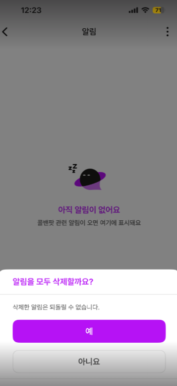

# 1-8 콜밴팟 알림 전체 삭제 취소 클릭

원문 페이지 ID: a990221954bc8222a42601febd8264a7

> 원문 스냅샷. 명세 확정·앱 배포·수집 완료를 뜻하지 않습니다.

## 원문 속성

```json
{
  "platform": [
    "ANDROID"
  ],
  "url": "source-page-id:a990221954bc8222a42601febd8264a7",
  "상태": "로깅 필요",
  "이름": "1-8 콜밴팟 알림 전체 삭제 취소 클릭",
  "태그": [
    "1. 메인 -> 콜밴팟"
  ]
}
```

<details>
<summary>과거 로깅</summary>

- 확인한 Android 코드 스냅샷(2026-11-08)에서 해당 동작의 기존 이벤트 전송은 확인되지 않았다. iOS·WEB 기존 전송 여부는 미확인이다.
</details>

<details>
<summary>새 로깅</summary>

- 설명: 알림 전체 삭제 확인창에서 아니요 버튼을 클릭할 때 1회 기록한다.
- screen\_view: <code>callvan_notification</code>
- event\_name: <code>DA2</code>
- event\_label: <code>callvan__callvan_notification__notification_list__delete_all_cancel__click</code>
- value: 아니요
- event\_category: <code>click</code>

<details>
<summary>검토사항</summary>

- 닫기 X·바깥 영역 터치·OS 뒤로가기를 이 버튼 클릭으로 합치지 않는다. 공통 onDismiss 콜백 전체에 로깅을 달지 말고 아니요 버튼에서만 기록한다.
- ANDROID·IOS·WEB에서 같은 기능은 같은 event\_label·screen\_view·event\_name을 사용한다. Android 동작만 저장 코드에서 확인했으므로 platform은 ANDROID로 등록했다. iOS·PC 웹·모바일 웹 지원은 미확인이며, 지원 확인 후 동일 계약으로 추가한다.
- 콜밴팟 전용 알림 계약이다. main의 공용 알림 및 team\_recruit 알림과 별개이며 한 클릭에 중복 전송하지 않는다.
- 명세 추가일: 2026-11-12. SDK 구현·배포·실수집·Silver 매핑 반영 완료를 뜻하지 않는다.
- 근거: 저장된 Android feature/callvan의 CallvanListScreen.kt, CallvanNotificationsScreen.kt, CallvanNotificationsViewModel.kt, CallvanConfirmBottomSheet.kt. 최신 원격 코드와 실기기 검수는 별도다.
</details>
</details>

### 참고사진 (1-10 콜밴팟 알림 전체 삭제 취소 클릭)

<b>웹</b>

<b>참고사진 · 웹 (모바일 웹)</b>


<b>모바일</b>

<b>참고사진 · 모바일</b>


